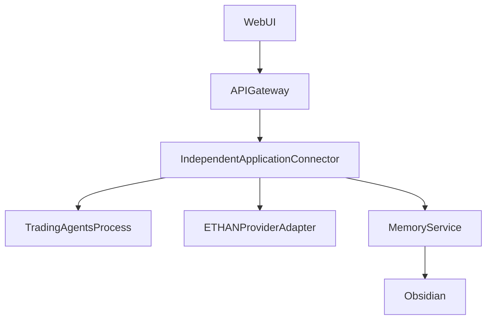

# TRADINGAGENTS_ARCHITECTURE.md

Date : 2026-11-03
Statut : PROPOSED
Statut associé : Phase 1.1, réconcilié avec le principe d'application indépendante.

## 1. Position de l'architecture

TradingAgents est une application indépendante. ETHAN ne l'absorbe pas et ne l'oblige pas à exécuter sous son contrôle.

Le moteur TradingAgents conserve son propre dépôt, ses dépendances, sa configuration locale et son cycle de vie.

ETHAN fournit une `plateforme centrale` et une `couche d'intégration` permettant de détecter l'application, vérifier sa présence, consulter son état et administrer les opérations autorisées.

Le `Knowledge/Architecture` et les rapports d'audit d'ETHAN documentent cet arrangement.

## 2. Responsabilités réelles

### TradingAgents (application indépendante)

- moteur multi-agents et logique d'analyse ;
- graphique LangGraph ;
- analystes, chercheurs, trader, gestionnaires ;
- données et résultats ;
- mémoire locale et checkpoints ;
- scripts CLI ;
- dépendances et environnement propre.

### ETHAN Core

- détection de l'application ;
- identité et version ;
- health check ;
- contrôleur dédié ;
- permissions ;
- audit trail ;
- accès aux rapports lorsqu'explicitement accordé ;
- réseau conditionnel.

### ETHAN WebUI

- présentation et navigation ;
- accès aux opérations autorisées ;
- transcription des capacités ;
- présentation des erreurs ;
- pas de duplication des données métier.

## 3. Architecture recommandée

La dépendance de santé est unidirectionnelle de ETHAN vers l'application. Si l'application est absente, ETHAN doit fonctionner.

## 4. Intégration ETHAN actuelle comme preuve

- `core/plugins/odin.py` et `core/plugins/frame.py` existent.
- `interfaces/api/routers/odin.py` et `interfaces/api/routers/frame.py` existent.
- Ils servent de modèle de contrôleur dédié non de règle universelle.

## 5. Contraintes obligatoires

- Ne pas exposer d'API arbitraire.
- Ne pas reposer sur les secrets internes de TradingAgents.
- Ne pas remplacer l'interface originale.
- Ne pas réécrire le code dans ETHAN.
- Ne pas ajouter de dépendance sans justification.
- Pas de dépendance au Render WebUI.

## 6. Alternatives

- Embedding direct : rejeté définitivement au déploiement.
- Control Process dédié : recommandé.
- Services sandboxés future: possible selon sécurité.
- RAG depuis la mémoire locale : non par défaut.

## 7. Inconnues

- Exact communication media exchange.
- Process health protocol.
- Integration of TradingAgents standalone API if any.
- Resource boundaries on local workstation.
- Release lifecycle across environments.

<!-- SHARED_INTELLIGENCE_SECTION -->

## Shared Intelligence Clarification

Les applications indépendantes peuvent demander à ETHAN des capacités d'intelligence compatibles, sans abandonner leur autonomie.

- l'application reste moteur propre ;
- ETHAN propose des capacités ;
- les LLM et modèles réutilisés uniquement après vérification ;
- les Knowledge et Skills restent sous leurs conditions de sécurité ;
- les déclarations d'agents sont distinctes des preuves.
- références : `../Knowledge/Architecture/ECOSYSTEM_SHARED_INTELLIGENCE_ARCHITECTURE.md`.
