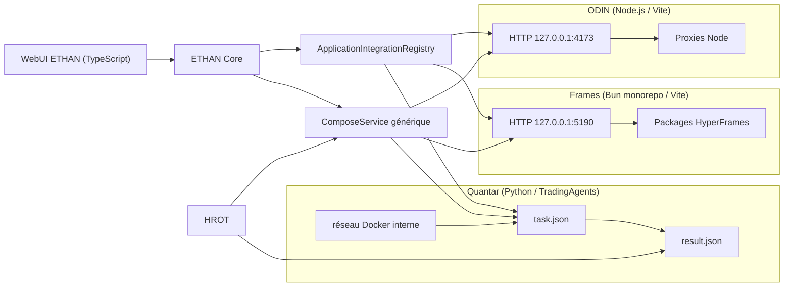
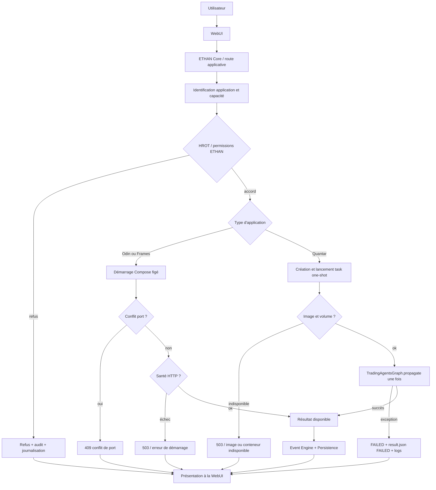

# ETHAN — Cartographie technique comparative ODIN / Frames / Quantar

Date : 2026-11-04
Statut : ÉTUDE DU CODE EXISTANT
Contrainte : aucune modification de code, configuration, dépendance, test ou donnée
Source analysée : dépôt `/home/fatsio/AI/Ethan`
Fichiers de référence principaux : `examples/odin`, `examples/frame`, `examples/quantar`, plugins ETHAN associés, intégrations application et routes API.

Convention de preuve :
- **FV** = fait vérifié dans le code ou un manifeste ;
- **DA** = déduction architecturale fondée sur des faits vérifiés ;
- **NI** = non identifié dans l'étude courante.

Aucune recommandation de migration Python/Rust n'est portée ici. L'objectif est de décrire l'existant et de préparer une décision sans l'influencer.

---

## 1. Synthèse exécutive

| Application | Langage principal | Runtime | Mode d'exécution observé | Supervision ETHAN | Point d'entrée authentifié ETHAN |
|---|---|---|---|---|---|
| **ODIN** | JavaScript/ECMAScript (`*.js`, `*.mjs`) sous Node.js | Vite dev server + proxies Node comme middleware | Service permanent, Docker ou hôte | `core/plugins/odin.py : OdinService`, Compose figé | `interfaces/api/routers/odin.py`, `/v1/plugins/odin/*` |
| **Frames / HyperFrames** | TypeScript et JavaScript, monorepo Bun | Bun workspace + packages `@hyperframes/*` + Vite pour studio | Service permanent, image Docker `frame-frame` | `core/plugins/frame.py : FrameService`, composant `ComposeService` | `interfaces/api/routers/frame.py`, `/v1/plugins/frame/*` |
| **Quantar** | Python ≥ 3.11, dépendances TradingAgents | Python in-process ou conteneur one-shot | Exécution unique d'une tâche, pas de daemon permanent | `core/plugins/quantar.py : QuantarService`, `core/applications/quantar_service.py` | `interfaces/api/routers/quantar.py` (cycle de vie/compose) |

Observation commune (**FV**) : les trois applications possèdent un `ethan-application-manifest.yaml` compatible avec le registre d'intégration ETHAN et déclarent des capacités distinctes.

---

## 2. ODIN

### 2.1 Langages et frameworks vérifiés

| Élément | Valeur observée | Preuve |
|---|---|---|
| Langage principal | JavaScript/ECMAScript, y compris modules ESM `.mjs` | `examples/odin/package.json`, `examples/odin/src/**/*.test.mjs` |
| Runtime Node.js | `>= 24.14.0 < 25` ou `>= 26 < 27` | `engines.node` dans `package.json` |
| Framework côté client | Vite | scripts `dev`, `build`, `preview` et `vite.config.js` |
| Proxies / API internes | Node.js, fournisseurs sous `server/providers` | répertoire `server/providers` |
| MCP | serveur stdio `server/mcp/stdio.js` | script npm `mcp` |
| Conteneur | image `node:24.14.0-slim`, port `4173` | `Dockerfile`, `compose.yaml` |
| Tests | Node test runner et scénarios QA Puppeteer | `scripts/run-unit-tests.mjs`, nombreux `.test.mjs` |

Dépendances principales observées (**FV**) :
`cesium`, `vite-plugin-cesium`, `hls.js`, `mapillary-js`, `@mapbox/vector-tile`, `pbf`, `satellite.js`, `@meri-imperiumi/eccodes-wasm`, `@jtarrio/signals`, `mgrs`, `egm96-universal`, `sharp`, `puppeteer`.

### 2.2 Organisation et points d'entrée

- Racine de l'application : `examples/odin`.
- Fichier d'entrée Vite : `vite.config.js` et point d'entrée web `index.html` (**FV** par présence de `index.html` et de `src/ui.js`).
- Backend léger embarqué dans le dev server Vite : proxies ADS-B, AIS, Overpass, OpenAI Realtime et autres selon `Dockerfile`.
- Serveur HTTP de développement : Vite sur `0.0.0.0:4173` en conteneur (**FV** : `PORT=4173`, `HOST=0.0.0.0`).
- Compose utilise un bind mount de la source et un volume `node_modules` afin de conserver les binaires Linux.
- Pas de base de données SQL vérifiée dans le périmètre ODIN (**NI** dans le code analysé).

### 2.3 Communication avec ETHAN

- Manifeste : `examples/odin/ethan-application-manifest.yaml`.
  - `app_id: odin`
  - capacités : `application.health.read`, `application.lifecycle.read`, `application.logs.read`, `application.control.start`, `application.control.stop`, `application.control.restart`
  - interface HTTP `http://127.0.0.1:4173`
  - API health `http://127.0.0.1:4173/api/health`
- Intégration Core : `core/applications/odin_integration.py`
  - validation du registre `ApplicationIntegrationRegistry` ;
  - vérification stricte de la présence des capacités de contrôle.
- FV : `core/plugins/odin.py` expose `OdinService`, détecte le conteneur Docker et le port, redacte les secrets, n'accepte que des verbes Compose figés.
- FV : `interfaces/api/routers/odin.py` et `interfaces/api/routers/odin_ai.py` existent.

### 2.4 Sécurité et autorisation

- Confinement strict au fichier `examples/odin/compose.yaml` (**FV** dans `OdinService._validate_confinement`).
- Argument Docker autorisé par allowlist figée, sans shell arbitraire (**FV** : `_is_allowed_docker_args`).
- Redaction automatique des motifs `api_key`, `token`, `secret`, `password`, `authorization`, `Bearer ...` (**FV** : `_redact_secrets`).
- Permissions ETHAN dans `interfaces/api/routers/odin.py` : **NI** du détail exact car le fichier n'a pas été relu entièrement lors de cette étude.
- Pas de preuve d'un pont HROT de type fournisseur pour ODIN (**NI** dans le code inspecté).

### 2.5 Tests et couverture

- Tests co-localisés sous `examples/odin/src/**/*.test.mjs`.
- Jeu de tests étendu : caméra, cockpit, contexte, key setup, QA, cartographie, etc. (**FV** par présence massive de fichiers `.test.mjs`).
- Seuil de couverture explicite : **NI** dans `package.json`.
- Infrastructure de test QA Puppeteer : **FV** par dépendance `puppeteer`.

---

## 3. Frames / HyperFrames (base)

### 3.1 Langages et frameworks vérifiés

| Élément | Valeur observée | Preuve |
|---|---|---|
| Nom package racine | `hyperframes-monorepo` | `examples/frame/package.json` |
| Langage | TypeScript et JavaScript | `tsx`, `typescript`, `scripts/*.ts`, `packages/*` |
| Runtime principal | Bun `1.4.4` | `engines.bun` |
| Gestionnaire | workspace Bun (`bun run --filter`) | scripts `build`, `test`, `studio` |
| Studio | Vite, port `5190` | `Dockerfile.frame`, `compose.yaml` |
| Publication type | image Docker `frame-frame` préconstruite renvoyée par Compose | `compose.yaml` |
| Dépendance racine visible | `yaml` | `dependencies` du package racine |
| Outils qualité | `oxlint`, `oxfmt`, `knip`, `vitest`, `happy-dom` | `devDependencies` |

Sous-packages observés par scripts (**FV**) :
`@hyperframes/{parsers, lint, studio-server, core, engine, producer, player, studio, shader-transitions, aws-lambda, gcp-cloud-run, sdk, inspector, cli, sdk-playground}`.

L'application ETHAN nommée "Frames" est donc la base HyperFrames intégrée dans `examples/frame`, projet upstream de rendu HTML-to-video orchestré par studio.

### 3.2 Organisation et points d'entrée

- Racine monorepo : `examples/frame`.
- Scripts principaux :
  - `dev` : `bun run studio`
  - `build` : build filtré des packages monorepo puis CLI et playground
  - `test` : `bun run test:unit`, soit `bun run --filter '*' test`
- Studio Vite démarre avec `--host 0.0.0.0 --port 5190` (**FV** dans `Dockerfile.frame`).
- Compose expose `127.0.0.1:5190:5190` et déclare une healthcheck `curl` (**FV**).
- Dockerfile.frame suppose une image `frame-frame` déjà disponible et ne reconstruit pas le repo complet à l'exécution (**DA** : conteneur final est basé sur une image intermédiaire).
- Structure présente : `packages`, `scripts`, `registry`, `skills`, `themes`, `assets`, `docs`, `plans`.

### 3.3 Communication avec ETHAN

- Manifeste : `examples/frame/ethan-application-manifest.yaml`.
  - `app_id: frame`
  - capacités : `application.health.read`, `application.lifecycle.read`, `application.logs.read`, `application.control.start`, `application.control.stop`, `application.control.restart`
  - interface HTTP `http://127.0.0.1:5190`
- Intégration Core : `core/applications/frame_integration.py`, validation stricte des capacités.
- FV : `core/plugins/frame.py` crée `FrameService(ComposeService)` sur le port `5190`.
- FV : `interfaces/api/routers/frame.py` expose status, start, stop, restart, logs, health, install, uninstall.
  - accès READ pour status/logs/health ;
  - accès PLUGINS pour start/stop/restart/install/uninstall.

### 3.4 Sécurité et autorisation

- Même modèle Compose que Frames : confinement, allowlist, redaction, pas de shell arbitraire (**FV** par `ComposeService`).
- Aucune preuve d'un pont HROT provider spécifique pour Frame (**NI**).
- Contrôle via permission ETHAN `Permission.READ` et `Permission.PLUGINS`.

### 3.5 Tests et couverture

- Tests unitaires lancés par package via `bun run --filter '*' test`.
- Tests scriptés massifs via Node et Vitest recensés dans le script `test` racine.
- Seuil de couverture : **NI** dans le périmètre consulté.

---

## 4. Quantar

### 4.1 Langage et frameworks vérifiés

| Élément | Valeur observée | Preuve |
|---|---|---|
| Nom projet | `tradingagents` | `pyproject.toml` |
| Version Python requise | `>= 3.11` | `project.requires-python` |
| Framework IA | LangChain, LangGraph | dépendances `langchain-*`, `langgraph*` |
| Providers LLM | OpenAI, Anthropic, Google GenAI, option AWS Bedrock | dépendances |
| Données financières | `yfinance`, `stockstats`, `pandas` | dépendances |
| CLI | `tradingagents = "cli.main:app"` (Typer) | `[project.scripts]` |
| Paquetage | setuptools ≥ 61 | `[build-system]` |
| Qualité | Ruff, pytest, pytest-subtests | extras `dev` |
| Conteneur | `python:3.12-slim`, utilisateur non privilégié UID/GID 1000 | `Dockerfile` |

### 4.2 Architecture applicative observée

- Racine locale ETHAN : `examples/quantar`.
- Code upstream TradingAgents inclut `tradingagents` et `cli` (**FV** par configuration setuptools `include = ["tradingagents*", "cli*"]`).
- `main.py` et `quantar_task_runner.py` sont présents à la racine.
- `quantar_task_runner.py` est explicitement un **one-shot** :
  - lit un fichier JSON de tâche (`QUANTAR_TASK_FILE` ou argument `--task-file`) ;
  - instancie `TradingAgentsGraph` ;
  - appelle `propagate(ticker, analysis_date)` une fois ;
  - sérialise le résultat dans un fichier `result.json` ;
  - sort avec un code de retour.
- Les données de communication conteneur tournent sur un volume nommé `quantar_task_data` monté en `/data/quantar`.
- Exécution in-process dans `core/applications/quantar_service.py` importe directement `tradingagents` si disponible (**FV** : import conditionnel au chargement).
- Docker one-shot est le mode production recommandé par le code ETHAN (**DA**, confirmé par docstring et Compose).
- Réseau conteneur `ethan_quantar_isolated` est `internal: true`, `attachable: false`.
- Stockage en lecture seule (`read_only: true`), `tmpfs /tmp`, `cap_drop: ALL`, `no-new-privileges:true`, limites CPU/memory/PID.

### 4.3 Communication avec ETHAN

- Manifeste : `examples/quantar/ethan-application-manifest.yaml`.
  - `app_id: quantar`
  - capacités : `research-analysis`, `reports`
  - entrée CLI `python main.py`
  - dépendance Python `>= 3.11`
- Intégration Core : `core/applications/quantar_integration.py`.
- ETHAN Core :
  - `core/applications/quantar_service.py` : tâches, statuts, runtimes Docker/in-process, reconciliation, metrics, annulation ;
  - `core/applications/quantar_provider_bridge.py` : pont HROT ;
  - `QuantarTask` avec `application_id="quantar"`, `execution_id`, logs, résultats, erreur, statut.
- FV : `QuantarProviderBridge` exige une approbation HROT durable (`HROT durable approval is required`) avant d'émettre une autorisation provider.
  - il appelle `verify_and_consume` avec paramètres figés (task, execution, application, provider, model, capability, resource, action) ;
  - refuse l'exécution si `principal_id` de l'autorisation ne correspond pas au `task_id`.
- Sécurité provider passant par `core/security/hrot_provider_gateway.py` : **FV** par import.
- FV : `QuantarService` est une sous-classe de `ComposeService`, avec `port=0`, détection de santé basée sur `docker compose ps`.

### 4.4 Tests et couverture

Tests Core observés :
`tests/core/test_quantar_manifest_phase34.py`, `test_quantar_pilot_phase35.py`, `test_quantar_phase40.py`, `test_quantar_phase45_reconciliation.py`, `test_quantar_provider_bridge.py`, `test_quantar_real_task_runtime.py`, `test_quantar_security_phase37a.py`, `test_quantar_service_phase36.py`.
- Markers pytest dans `pyproject.toml` : `unit`, `integration`, `smoke`.
- `addopts` ignore les tests marqués `integration` par défaut.
- Tests applicatifs sous `examples/quantar/tests` : **FV** par présence du répertoire, non dénombrés.
- Seuil de couverture global : **NI**.

---

## 5. Tableau comparatif ODIN / Frames / Quantar

| Axe | ODIN | Frames / HyperFrames | Quantar |
|---|---|---|---|
| **Langage** | JS/ESM (Node) | TS et JS (Bun) | Python ≥ 3.11 |
| **Framework principal** | Vite + Node HTTP middleware | Bun workspace + Vite studio + packages `@hyperframes` | TradingAgents + LangChain/LangGraph |
| **Dépendances clé** | Cesium, vector tiles, hls, mapillary, satellite, eccodes WASM | `yaml`, nombreux sous-packages, outils bun/tsup/vitest | LangChain, LangGraph, yfinance, stockstats, pandas, typer |
| **Organisation** | application monolithique frontale avec proxies | monorepo multi-packages | package Python + CLI + runner one-shot |
| **Point d'entrée** | `npm run dev` / Docker `scripts/docker-start.mjs` | `bun run studio` / image `frame-frame` | `python main.py`, script `tradingagents`, `quantar_task_runner.py` |
| **Port / interface** | `127.0.0.1:4173` | ` 127.0.0.1:5190` | aucune interface réseau propre ; fichiers task/result |
| **Mode d'exécution** | service permanent | service permanent | one-shot, in-process possible mais conteneur one-shot préféré |
| **Base de données** | NI | NI | NI dans manifeste ; résultat JSON sur volume Docker |
| **Environnement** | bind mount source + volume node_modules | image Docker pré-construite | image Python, filesystem read-only, tmpfs, réseau isolé |
| **Supervision ETHAN** | `OdinService` | `FrameService` (ComposeService) | `QuantarService` (ComposeService + task runtime) |
| **Permissions API ETHAN** | à confirmer exactement pour Odin ; modèle READ/PLUGINS dans routeurs équivalents (**NI** pour le détail odin) | READ et PLUGINS | capacités manifeste : `read:system-health`, `read:analysis-artifacts` |
| **HROT fournisseur** | non identifié | non identifié | implémenté via `QuantarProviderBridge` |
| **Tests** | nombreux `.test.mjs`, QA Puppeteer | tests par package, lints, Vitest | pytest Core + exemples ; markers unit/integration/smoke |
| **Couverture** | NI | NI | NI |

---

## 6. Schéma Mermaid — relations applications / ETHAN

---

## 7. Schéma Mermaid — scénario d'exécution avec erreurs possibles

---

## 8. Exploitabilité par les agents

### 8.1 Où intervenir selon la nature de la modification

| Besoin | Composant à modifier | Ne pas modifier |
|---|---|---|
| Cycle de vie Docker ODIN | `core/plugins/odin.py` et `interfaces/api/routers/odin.py` | logique interne d'ODIN dans `examples/odin` hors contrat |
| Cycle de vie Frames | `core/plugins/frame.py` et `interfaces/api/routers/frame.py` | build packs HyperFrames sans revue downstream |
| Exécution d'analyse Quantar | `core/applications/quantar_service.py` et `examples/quantar/quantar_task_runner.py` | bypasser le bridge HROT |
| Intégration application | `core/applications/*_integration.py` et manifestes YAML | créer une seconde classe de supervision par application |
| Sécurité provider | `core/security/hrot_provider_gateway.py` et `core/applications/quantar_provider_bridge.py` | aucune autorisation ad hoc hors HROT |
| Documentation architecture | `Obsidian/Architecture/...` uniquement | code ETHAN sans décision |

### 8.2 Contraintes à respecter

- Ne pas traiter les trois applications comme une même stack technologique.
- ODIN et Frames sont des services permanents HTTP ; Quantar est un moteur de tâche one-shot.
- Toute demande d'exécution Quantar sensible doit rester liée à une autorisation HROT durable.
- ODIN contient un grand nombre de tests, mais aucun seuil de couverture n'a été identifié ; ne pas supposer une couverture totale.
- Frames dépend d'une image Docker préconstruite ; une modification du build amont peut casser le déploiement sans changement côté ETHAN.
- Quantar dépend de l'installation locale de `tradingagents` ; l'absence de dépendance rend l'in-process indisponible, tandis que le mode Docker peut rester possible selon l'image.
- Le réseau Quantar est isolé ; ne pas supposer l'accès sortant en conteneur.
- Les conteneurs ODIN et Frames sont des frontières d'application ; ETHAN ne leur impose qu'un cycle de vie, pas un runtime commun.

### 8.3 Tests existants à consulter

- ODIN :
  - `examples/odin/src/**/*.test.mjs`
  - `npm run test`
- Frames :
  - `bun run test` / `bun run test:unit`
  - tests Node/Vitest dans `scripts`
- Quantar :
  - `pytest` avec markers `unit`, `integration`, `smoke`
  - tests Core Quantar listés à la section 4.4
- ETHAN services :
  - `tests/core/test_odin.py`
  - `tests/core/test_odin_compose_controller.py`
  - `tests/core/test_frame.py`
  - `tests/core/test_frame_pilot_phase20.py`
  - tests Core Quantar listés à la section 4.4.

---

## 9. Documentation associée et limites de l'étude

- [ETHAN_ARCHITECTURE_VISION.md](ETHAN_ARCHITECTURE_VISION.md)
- [ARCHITECTURE-CIBLE.md](System/ARCHITECTURE-CIBLE.md)
- [README_ARCHITECTURE_REFERENCE.md](System/README_ARCHITECTURE_REFERENCE.md)
- [ADR-4006 — architecture cible rebuild ETHAN](ADR/ADR-4006-rebuild-target-architecture.md)
- [ADR-4008 — shadow mode migration Rust event store](ADR/ADR-4008-rust-event-store-shadow-mode.md)
- [Modèle de permissions](../Knowledge/Sécurité/PERMISSION_MODEL.md)
- [Index Obsidian](../INDEX.md)

Limites connues de cette étude :
1. Les détails internes exacts de `interfaces/api/routers/odin.py` n'ont pas été relevés intégralement.
2. Les seuils de couverture pour les trois applications n'ont pas été identifiés.
3. Les dépendances spécifiques de chaque sous-package HyperFrames n'ont pas été inspectées ; seule l'orchestration racine a été vérifiée.
4. Les scripts de démarrage ODIN (`scripts/docker-start.mjs`) n'ont pas été relus ligne à ligne.
5. La présence ou l'absence de bases de données dans ODIN et Frames n'est pas établie par cette étude.
6. `Quantar` peut être exécuté in-process, mais la disponibilité de `tradingagents` dépend de l'environnement.

## 10. Statut de réalisation synthétique

| Composant | Statut |
|---|---|
| Manifeste applicatif ODIN | EXISTING |
| Service Odin `OdinService` | EXISTING |
| Supervision Compose générique | EXISTING |
| Manifeste applicatif Frame | EXISTING |
| Service Frame `FrameService` | EXISTING |
| Service Quantar et runtime task | EXISTING |
| pont HROT Quantar | EXISTING |
| Séparation applications / Core | EXISTING |
| Port HROT pour Odin/Frame | PROPOSED / NON IDENTIFIÉ |
| Couverture de tests formalisée pour les apps | PROPOSED |
| Seuil de couverture applicatif | PROPOSED |
