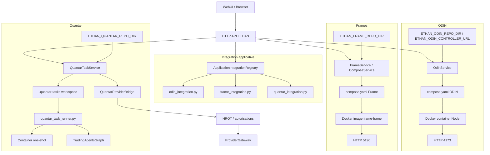

# ETHAN — Cartographie des intégrations ODIN / Frames / Quantar

Date : 2026-11-04
Statut : ÉTUDE DE CODE EXISTANT
Chemin demandé : `Obsidian/Architecture/Applications/APP_INTEGRATION_MAP.md`
Source analysée : dépôt `/home/fatsio/AI/Ethan`

Convention de preuve :
- **FV** = fait vérifié dans le code ;
- **DA** = déduction architecturale fondée sur des faits vérifiés ;
- **NI** = non identifié.

Aucune modification de code ou de configuration.

---

## 1. Composants d'intégration et responsabilités

| Composant | Localisation | Responsabilité réelle | Applications servies |
|---|---|---|---|
| ApplicationIntegrationRegistry | `core/applications/application_registry.py` | validation et enregistrement des manifestes applicatifs | ODIN, Frames, Quantar |
| OdinService | `core/plugins/odin.py` | cycle de vie et état réel Docker local | ODIN |
| FrameService | `core/plugins/frame.py` | instance de `ComposeService` pour Frame | Frames |
| QuantarService | `core/plugins/quantar.py` | Compose optionnel pour runtime Docker autonome de Quantar | Quantar |
| QuantarTaskService | `core/applications/quantar_service.py` | tâches, statuts, exécution one-shot, persistance et réconciliation | Quantar |
| QuantarProviderBridge | `core/applications/quantar_provider_bridge.py` | gestion des autorisations HROT avant provider | Quantar |
| ComposeService | `core/plugins/compose_service.py` | orchestrateur générique fixé à un fichier `compose.yaml` | Frames, Quantar (runtime autonome), autres hypothétiques |
| Routers API | `interfaces/api/routers/odin.py`, `frame.py`, `quantar.py` | exposition HTTP protégée | ODIN, Frames, Quantar |
| WebUI | `interfaces/webui/` | affichage, déclenchement, suivi | ODIN, Frames, Quantar |
| Installation / configuration applicative | variables d'environnement et manifestes | paramètres runtime et chemins | toutes |

---

## 2. Diagramme global Mermaid

---

## 3. ODIN — Intégration réelle

### Qui initialise ?
- `OdinService` est instancié à la demande côté Core ; `get_odin_service()` utilise un singleton pour préserver la traçabilité d'état.
- L'enregistrement pilot n'est effectué par `register_odin_pilot()` qu'après validation du manifeste, sans démarrage automatique.

### Qui contrôle le cycle de vie ?
- ODIN possède son propre contrôleur, distinct de `ComposeService`.
- `OdinService` exécute directement des commandes `docker compose` figées pour le seul projet `odin`.
- En présence de `ETHAN_ODIN_CONTROLLER_URL`, OdinService peut déléguer l'exécution vers un contrôleur HTTP synchronisé, avec token (`ETHAN_ODIN_CONTROLLER_TOKEN`).
- L'API expose start/stop/restart, logs, health, install/uninstall.

### Communication avec ETHAN
- Manifeste : `examples/odin/ethan-application-manifest.yaml`.
- Routes : `interfaces/api/routers/odin.py` et `odin_ai.py`.
- L'application expose `http://127.0.0.1:4173` et `http://127.0.0.1:4173/api/health`.
- Compose est bind-mounté sous `examples/odin`, avec volume `node_modules` conservé dans l'image.

### Permissions observées
- Lecture : `Permission.READ`.
- Contrôle : `Permission.PLUGINS`.
- Le détail exact de chaque endpoint est visible, mais l'application d'HROT provider n'est pas prouvée pour ODIN (**NI**).

### Données et accès
- ODIN lit sa propre configuration via `.env` et setup local ; l'accès aux secrets est redacté dans les logs.
- Aucune preuve d'écriture dans une base SQL ETHAN par ODIN.
- La configuration d'application est portée par le repo et le conteneur, non par une base ETHAN.

### Erreurs et indisponibilités
- ODINService renvoie des états standardisés (`running`, `starting`, `error`, etc.).
- Les timeouts et erreurs d'exécution sont capturés et rédigés.
- Les verbes Docker sont figés, ce qui limite les opérations dangereuses.

### Indépendance du Core
- ODIN peut fonctionner seul en conteneur ou hôte via Vite et les proxies Node.
- ETHAN ne déclenche pas un démarrage automatique au boot.
- L'exposition est locale et confinée.

### Points de fragilité constatés
- ODIN dépend d'un répertoire canonique `examples/odin`, avec validation de confinement stricte.
- Le pont controller HTTP ajoute une dépendance optionnelle dont les contrôles d'autorisation détaillés ne sont pas visibles dans l'étude courante.
- Les secrets sont redactés, mais leur stockage dans `.env` sur le bind mount persiste en dehors du Core.

---

## 4. Frames / HyperFrames — Intégration réelle

### Qui initialise ?
- `FrameService` est un wrapper de `ComposeService` initialisé via `get_frame_service()`.
- `register_frame_pilot()` valide le manifeste sans lancer le service.

### Qui contrôle ?
- Frame utilise directement le mécanisme partagé `ComposeService` sur le projet `frame`.
- Les seules actions disponibles sont des verbes figés.

### Communication avec ETHAN
- Manifeste : `examples/frame/ethan-application-manifest.yaml`.
- Routing HTTP : `http://127.0.0.1:5190`.
- API HTTP : `http://127.0.0.1:5190/`.
- Routes ETHAN : `interfaces/api/routers/frame.py`.
- Compose utilise une image `frame-frame` déjà construite.

### Permissions observées
- Lecture : `Permission.READ`.
- Contrôle : `Permission.PLUGINS`.

### Données et accès
- Frames est visuellement une couche de création et de rendu vidéo.
- Aucune écriture base SQL ETHAN n'est prouvée.
- Son dépôt monorepo est référencé localement et démarre le studio Vite.

### Indépendance du Core
- Le studio Frame peut être démarré indépendamment par Bun.
- ETHAN ne constitue qu'une couche de contrôle et de santé.

### Points de fragilité
- Dépendance à une image Docker `frame-frame` déjà présente ; `docker compose build` n'est pas utilisé par `ComposeService`.
- Le Compose est confiné à `examples/frame`, ce qui évite l'exécution arbitraire mais impose un chemin canonique.
- Le monorepo est très volumineux ; le démarrage réel dépend de ses packages.

---

## 5. Quantar — Intégration réelle

### Qui initialise ?
- `QuantarService` est un wrapper `ComposeService` pour le runtime Docker autonome.
- `QuantarTaskService` est le vrai moteur applicatif pour tâches réelles à l'intérieur du Core.
- Il charge les tâches persistées au démarrage.

### Qui contrôle ?
- API quantar expose préparation, démarrage, annulation et réconciliation.
- L'exécution réelle peut être in-process ou one-shot Docker selon le mode.
- La permission de contrôle est `Permission.PLUGINS` pour cancel/start-lifecycle, `Permission.READ` pour la plupart des consultations.

### Communication avec ETHAN
- Manifeste : `examples/quantar/ethan-application-manifest.yaml`.
- Capacités : `research-analysis`, `reports`.
- Pont HROT : `QuantarProviderBridge`.
- Proxy provider : `ProviderGateway`.

### HROT et frontières de confiance
- `QuantarProviderBridge.prepare_authorization()` refuse l'émission si `hrot_approval_id` est absent.
- L'autorisation HROT durable est vérifiée par `verify_and_consume`.
- Si non approuvé, une erreur explicite est levée.
- `execute()` vérifie que `authorization.principal_id == task.task_id`, ce qui empêche l'échange d'autorisation entre tâches.
- Les paramètres provider sont fixés par le pont et ne viennent pas de la WebUI.

### Données et persistance
- `QuantarTaskService.workspace_root` vaut par défaut `Path.cwd() / ".quantar-tasks"`.
- Les tâches sont persistées sous `workspace/<task_id>/state.json`.
- Les résultats sont sous `workspace/<task_id>/result.json`.
- Les logs sont référencés sous `workspace/<task_id>/logs.json`.
- Au démarrage, les tâches non terminées passent en `RECONCILING`.
- Les données du conteneur one-shot utilisent un volume `quantar_task_data` monté en `/data/quantar` selon l'architecture observée (reprécise le fichier Compose avant tout usage de production).

### Erreurs et indisponibilités
- Le moteur distingue `COMPLETED`, `FAILED`, `CANCELLED`, `INTERRUPTED`, `RECONCILING`.
- `TradingAgents` peut être indisponible, ce qui rend le runtime `unavailable`.
- La réconciliation gère les conteneurs dont l'état ne correspond plus au task store.
- Les caches et résultats sont relus et invalidés si incohérents.

### Indépendance du Core
- Le runner `quantar_task_runner.py` est invocable manuellement avec `--task-file`.
- Les résultats sont des fichiers JSON.
- Le package Python peut fonctionner hors ETHAN si ses dépendances sont installées.
- Comme application ETHAN, l'enregistrement et l'orchestration sont portés par le Core.

### Points de fragilité
- Plusieurs objets coexisteront : `QuantarService` Compose et `QuantarTaskService` applicatif.
- Le runtime in-process dépend de l'import de TradingAgents dans l'environnement Core.
- La persistance est basée sur des fichiers locaux, avec réconciliation nécessaire après redémarrage.
- Le volume/réseau Docker de Quantar doit être audité sur le fichier réel avant production.

---

## 6. Flux de communication

### ODIN
WebUI -> API Node(Control) -> OdinService -> docker compose -> conteneur Node -> port 4173.

### Frames
WebUI/API -> FrameService (ComposeService) -> docker compose -> image frame-frame -> studio 5190.

### Quantar
WebUI/API -> QuantarTaskService -> persistance locale + option conteneur one-shot -> TradingAgents -> `result.json` -> réconciliation -> API.

### Provider utilisé par Quantar
QuantarTask -> QuantarProviderBridge -> HROT -> ProviderGateway -> provider LLM.

---

## 7. Frontières de confiance

| Frontière | ODIN | Frames | Quantar |
|---|---|---|---|
| chemin repo canonique | strict | strict | strict |
| verbes Docker | allowlist figée | allowlist figée | allowlist figée |
| ports exposés | 4173 local | 5190 local | aucun port HTTP direct ; résultats par fichiers |
| secrets | redaction dans logs et scripts | secrets redactés | secrets dépendent des providers et HROT |
| provider HROT | aucune preuve | aucune preuve | obligatoire avant exécution |
| accès DB ETHAN | aucune preuve | aucune preuve | state store et persistance via `store`/fichiers |

---

## 8. Dépendances et responsabilités dupliquées

### Dépendances applicatives
- ODIN et Frames : non dépendantes de Python.
- Quantar : dépendant de Python, du framework TradingAgents et de LLMs externes.

### Dépendances internes
- `OdinService` garde une implémentation Docker spécifique, tandis que Frame et le runtime autonome de Quantar partagent `ComposeService` pour les verbes figés.
- L'intégration s'appuie sur `ApplicationIntegrationRegistry` pour les manifestes et les routes API pour les opérations.
- Quantar possède deux couches complémentaires : service Compose et `QuantarTaskService`, sans dépendance circulaire visible.

### Responsabilités dupliquées potentielles
- ODIN possède un contrôleur Docker propre et n'utilise pas directement `ComposeService`, ce qui peut doubler la logique d'audit ou de maintenance.
- Frames et Quantar partagent `ComposeService`, mais Quantar y ajoute une orchestration applicative substantielle.
- Les services singleton sont créés à la demande, ce qui évite le démarrage automatique mais impose une gestion cohérente des singletons dans les tests.

### Points de fragilité constatés
- Le Core dépend d'un `cwd` pour Quantar, avec risque d'écrire les tâches au mauvais emplacement.
- ComposeService est confiné à un chemin exact, ce qui complique le test dans un environnement délocalisé.
- ODIN et Frames dépendent de ports locaux fixes, avec risque de conflits.
- Les images Docker des apps ne sont pas nécessairement reconstruites par ETHAN : cela suppose un environnement préparé.
- La frontière provider de Quantar impose une approbation HROT durable, sans quoi l'exécution échoue explicitement.

---

## 9. Conclusion

- ODIN et Frames sont des applications autonomes contrôlées par ETHAN via des Compose figés.
- Quantar a une architecture hybride unique : contrôle Compose statique plus moteur réel de tâches.
- L'authentification applicative est principalement fondée sur `Permission.READ` et `Permission.PLUGINS`, pas sur HROT côté Odin et Frames.
- Le seul pont HROT applicatif visible est QuantarProviderBridge.
- Aucune méthode Docker universelle n'est aujourd'hui exigée par l'architecture ; Odin garde son contrôleur indépendant, Frame utilise `ComposeService`, et Quantar conserve son one-shot.

Point NI central : le détail exact des flux HumanRoot internes et des routeurs frontend n'a pas été relu entièrement dans cette mission, mais les frontières de confiance ont été tirées des plugins, services et routes Core.
