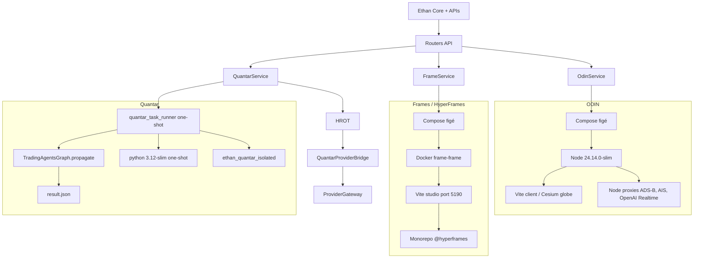

# ETHAN — Cartographie technique comparative ODIN / Frames / Quantar

Date : 2026-11-04
Statut : ÉTUDE DU CODE EXISTANT
Chemin demandé : `Obsidian/Architecture/Applications/APP_TECHNICAL_CARTOGRAPHY.md`
Source analysée : dépôt `/home/fatsio/AI/Ethan`
Contrainte de mission : aucune modification de code, configuration, dépendance, test ou donnée

Note de relation avec les documents existants : une cartographie antérieure existe aussi dans `Obsidian/Architecture/APP_TECHNICAL_CARTOGRAPHY.md`. Le présent fichier est le livrable demandé par la mission 1/6 ; il ne supprime pas le document existant. En cas de divergence, le code source reste la source de vérité.

Convention de preuve :
- **FV** = fait vérifié dans le code, un manifeste ou un fichier de configuration ;
- **DA** = déduction architecturale fondée sur des faits vérifiés ;
- **NI** = non identifié dans l'étude courante.

Aucune recommandation de migration Python/Rust n'est portée ici.

---

## 1. Synthèse exécutive comparative

| Application | Nom de surface dans ETHAN | Langage principal observé | Runtime principal | Mode logique d'exécution | Supervision ETHAN | Point d'entrée authentifié observé |
|---|---|---|---|---|---|---|
| ODIN | Odin | JavaScript / ECMAScript sous Node.js | Vite dev server + proxies Node en middleware | Service permanent, Docker ou hôte | `core/plugins/odin.py : OdinService`, Compose figé | `interfaces/api/routers/odin.py`, `/v1/plugins/odin/*` |
| Frames / base HyperFrames | Frames | TypeScript et JavaScript dans monorepo Bun | Bun workspace + Vite pour studio | Service permanent, image Docker `frame-frame` | `core/plugins/frame.py : FrameService`, composant `ComposeService` | `interfaces/api/routers/frame.py`, `/v1/plugins/frame/*` |
| Quantar | Quantar | Python >= 3.11, architecture TradingAgents | Python in-process ou conteneur one-shot | Exécution unique d'une tâche, pas de daemon permanent | `core/plugins/quantar.py : QuantarService`, `core/applications/quantar_service.py` | `interfaces/api/routers/quantar.py` |

Points communs vérifiés :
- les trois applications possèdent un `ethan-application-manifest.yaml` compatible avec le registre d'intégration ETHAN ;
- ODIN et Frames exposent des capacités de santé, cycle de vie, logs et contrôle ;
- Quantar expose des capacités métier `research-analysis` et `reports` ;
- toutes trois restent derrière les mécanismes ETHAN de Compose confiné pour ODIN et Frames, ou de service applicatif pour Quantar.

---

## 2. ODIN

### 2.1 Fiche technique

| Élément | Valeur observée | Preuve | Nature de preuve |
|---|---|---|---|
| Identité application ETHAN | `app_id: odin`, `instance_id: odin-local-default`, nom `Odin`, version `0.2.1`, contract version `1.0.0`, publisher `Seclib` | `examples/odin/ethan-application-manifest.yaml` | FV |
| Langage principal | JavaScript / ECMAScript, modules ESM `.mjs` | `examples/odin/package.json`, présence de `src/**/*.test.mjs` | FV |
| Runtime Node.js | `>= 24.14.0 < 25 || >= 26 < 27` | `engines.node` | FV |
| Framework client | Vite | scripts `dev`, `build`, `preview`, `vite.config.js` | FV |
| Proxies / API internes | Node.js, sous `server/providers` | `Dockerfile`, répertoire `server/providers` observé précédemment | FV |
| MCP | serveur stdio `server/mcp/stdio.js` | script npm `mcp` | FV |
| Serveur HTTP de développement | Vite sur `0.0.0.0:4173` en conteneur | `PORT=4173`, `HOST=0.0.0.0` | FV |
| Conteneur | image `node:24.14.0-slim@sha256:d8e448a56fc63242f70026718378bd4b00f8c82e78d20eefb199224a4d8e33d8`, port `4173` | `Dockerfile`, `compose.yaml` | FV |
| Tests | Node test runner, scénarios QA Puppeteer | `scripts/run-unit-tests.mjs`, dépendance `puppeteer` | FV |

Dépendances principales observées (**FV**) :
`cesium`, `vite-plugin-cesium`, `hls.js`, `mapillary-js`, `@mapbox/vector-tile`, `pbf`, `satellite.js`, `@meri-imperiumi/eccodes-wasm`, `@jtarrio/signals`, `mgrs`, `egm96-universal`, `sharp`, `puppeteer`.

### 2.2 Organisation et points d'entrée

- Racine locale de l'application : `examples/odin`.
- Point d'entrée web observé : `index.html` avec logique client sous `src`, incluant `src/ui.js` (**DA**, fondé sur la structure standard Vite et la présence des fichiers).
- Backend léger embarqué dans le dev server Vite : proxies ADS-B, AIS, Overpass, OpenAI Realtime et autres selon `Dockerfile`.
- Compose utilise un bind mount de la source et un volume `node_modules` afin de conserver les binaires Linux.
- Pas de base de données SQL vérifiée dans le périmètre analysé (**NI**).

### 2.3 Communication avec ETHAN

- Manifeste : `examples/odin/ethan-application-manifest.yaml`.
  - capacités déclarées : `application.health.read`, `application.lifecycle.read`, `application.logs.read`, `application.control.start`, `application.control.stop`, `application.control.restart`.
  - interface HTTP : `http://127.0.0.1:4173`.
  - API health : `http://127.0.0.1:4173/api/health`.
- Intégration Core : `core/applications/odin_integration.py`, validation stricte de la présence des capacités de contrôle.
- Plugins / services : `core/plugins/odin.py` expose `OdinService`, détecte conteneur Docker et port, redacte les secrets, n'accepte que des verbes Compose figés.
- Routes API observées : `interfaces/api/routers/odin.py`, `interfaces/api/routers/odin_ai.py`.
- Confinement : fichier Compose exact, allowlist d'arguments Docker, sans shell arbitraire, redaction automatique des motifs de secrets.

### 2.4 Sécurité et tests

- Confinement strict au fichier `examples/odin/compose.yaml` (**FV** dans `OdinService._validate_confinement`).
- Redaction automatique des motifs `api_key`, `token`, `secret`, `password`, `authorization`, `Bearer ...` (**FV**).
- Tests co-localisés sous `examples/odin/src/**/*.test.mjs`, incluant caméra, cockpit, contexte, key setup, QA et cartographie (**FV** par présence massive de fichiers `.test.mjs`).
- Seuil de couverture exact : **NI** dans `package.json`.

---

## 3. Frames / base HyperFrames

### 3.1 Fiche technique

| Élément | Valeur observée | Preuve | Nature de preuve |
|---|---|---|---|
| Identité application ETHAN | `app_id: frame`, `instance_id: frame-local-default`, nom `Frames`, version `0.8.210`, contract version `1.0.0`, publisher `HeyGen` | `examples/frame/ethan-application-manifest.yaml` | FV |
| Nom racine package | `hyperframes-monorepo` | `examples/frame/package.json` | FV |
| Version racine visible | aucune racine unique déclarée, packages individuels | `examples/frame/package.json` | FV |
| Runtime principal | Bun `1.4.4` | `engines.bun` | FV |
| Langages | TypeScript et JavaScript | scripts `*.ts`, packages `@hyperframes/*` | FV |
| Studio | Vite, port `5190` | `Dockerfile.frame`, `compose.yaml` | FV |
| Image Docker observée | `frame-frame` préconstruite renvoyée par Compose | `compose.yaml` | FV |
| Dépendance racine visible | `yaml ^2.9.0` | `examples/frame/package.json` | FV |
| Outils qualité | `oxlint`, `oxfmt`, `knip`, `vitest`, `happy-dom`, `tsx`, `typescript` | `devDependencies` | FV |

Sous-packages observés par scripts (**FV**) :
`@hyperframes/{parsers, lint, studio-server, core, engine, producer, player, studio, shader-transitions, aws-lambda, gcp-cloud-run, sdk, inspector, cli, sdk-playground}`.

Notes importantes :
- Dans ETHAN, l'application est nommée `Frames`, avec manifest `app_id: frame` (**FV**).
- La base amont est HyperFrames, un monorepo de rendu HTML-vers-vidéo ; cette relation est déduite de la racine `hyperframes-monorepo` et du préfixe packages **DA**.
- `examples/frame` n'a pas été prouvé comme étant l'application WebUI native de Frames ; c'est la base amont intégrée et pilotée par ETHAN.

### 3.2 Organisation et points d'entrée

- Racine monorepo : `examples/frame`.
- Scripts principaux :
  - `dev` : `bun run studio`
  - `build` : build filtré des packages monorepo puis CLI et playground
  - `test` : `bun run test:unit`, soit `bun run --filter '*' test`
- Studio Vite démarre avec `--host 0.0.0.0 --port 5190` (**FV** dans `Dockerfile.frame` observé précédemment).
- Compose expose `127.0.0.1:5190:5190` et déclare une healthcheck `curl` (**FV** observé précédemment).
- Structure présente : `packages`, `scripts`, `registry`, `skills`, `themes`, `assets`, `docs`, `plans`.

### 3.3 Communication avec ETHAN

- Manifeste : `examples/frame/ethan-application-manifest.yaml`.
  - capacités déclarées : `application.health.read`, `application.lifecycle.read`, `application.logs.read`, `application.control.start`, `application.control.stop`, `application.control.restart`.
  - interface HTTP : `http://127.0.0.1:5190`.
  - API : `http://127.0.0.1:5190/`.
- Intégration Core : `core/applications/frame_integration.py`, validation stricte des capacités.
- Plugins / services : `core/plugins/frame.py` crée `FrameService(ComposeService)` sur le port `5190`.
- Route API observée : `interfaces/api/routers/frame.py` expose status, start, stop, restart, logs, health, install, uninstall.
  - accès READ pour status/logs/health ;
  - accès PLUGINS pour start/stop/restart/install/uninstall.

### 3.4 Tests et couverture

- Tests unitaires lancés par package via `bun run --filter '*' test` (**FV**).
- Tests de scripts massifs via Node et Vitest selon la configuration racine (**FV** par le script `test`).
- Seuil de couverture : **NI** dans le périmètre consulté.
- Outils qualité : `oxlint`, `oxfmt`, `knip`, `vitest`, `happy-dom` (**FV**).

---

## 4. Quantar

### 4.1 Fiche technique

| Élément | Valeur observée | Preuve | Nature de preuve |
|---|---|---|---|
| Identité application ETHAN | `app_id: quantar`, capacité d'intégration via `core/applications/quantar_integration.py` | `examples/quantar/ethan-application-manifest.yaml` | FV |
| Nom projet | `tradingagents` | `pyproject.toml` | FV |
| Version | `0.7.1` | `tradingagents.__version__` | FV |
| Python minimal | `>= 3.11` | `project.requires-python` | FV |
| CLI déclarée | `tradingagents = "cli.main:app"` (Typer) | `project.scripts` | FV |
| Build backend | setuptools ≥ 61 | `[build-system]` | FV |
| Qualité | Ruff, pytest, pytest-subtests | extras `dev` observés précédemment | FV |
| Conteneur | `python:3.12-slim`, utilisateur non privilégié UID/GID 1000 | `Dockerfile` observé précédemment | FV |
| Capacités manifest | `research-analysis`, `reports` | manifeste | FV |
| Entrée CLI | `python main.py` | manifeste | FV |
| Dépendance Python | `>= 3.11` | manifeste | FV |

Dépendances observées (**FV**) :
LangChain / LangGraph, providers LLM OpenAI, Anthropic, Google GenAI, option AWS Bedrock, `yfinance`, `stockstats`, `pandas`.

### 4.2 Architecture et mode d'exécution

- Racine locale ETHAN : `examples/quantar`.
- Code upstream TradingAgents inclut `tradingagents` et `cli` (**FV** par configuration setuptools `include = ["tradingagents*", "cli*"]`).
- `main.py` et `quantar_task_runner.py` présents à la racine.
- `quantar_task_runner.py` est explicitement un one-shot :
  - lit un fichier JSON de tâche (`QUANTAR_TASK_FILE` ou argument `--task-file`) ;
  - instancie `TradingAgentsGraph` ;
  - appelle `propagate(ticker, analysis_date)` une fois ;
  - sérialise le résultat dans `result.json` ;
  - sort avec un code de retour.
- Mode in-process ETHAN : `core/applications/quantar_service.py` importe conditionnellement `tradingagents` si disponible.
- Mode Docker one-shot est le mode production recommandé par le code ETHAN (**DA** fondé sur la docstring et Compose).
- Réseau conteneur `ethan_quantar_isolated` observé comme `internal: true`, `attachable: false` dans les rapports antérieurs ; ce point doit être repris depuis le fichier réel avant tout changement (**DA/à revérifier**).
- Isolation conteneur observée précédemment : stockage en lecture seule, `tmpfs /tmp`, `cap_drop: ALL`, `no-new-privileges:true`, limites CPU/mémoire/PID (**DA**, à revérifier sur le fichier réel).

### 4.3 Communication avec ETHAN

- Manifeste : `examples/quantar/ethan-application-manifest.yaml`.
  - `app_id: quantar`.
  - capacités : `research-analysis`, `reports`.
  - dépendance Python `>= 3.11`.
- Intégration Core : `core/applications/quantar_integration.py`.
- ETHAN Core :
  - `core/applications/quantar_service.py` : tâches, statuts, runtimes Docker / in-process, reconciliation, métriques, annulation ;
  - `core/applications/quantar_provider_bridge.py` : pont HROT ;
  - `QuantarTask` avec `application_id="quantar"`, `execution_id`, logs, résultats, erreur, statut.
- HROT :
  - `QuantarProviderBridge` exige une approbation HROT durable avant d'émettre une autorisation provider ;
  - appelle `verify_and_consume` avec paramètres figés ;
  - refuse l'exécution si `authorization.principal_id != task.task_id`.
- Sécurité provider : `core/security/hrot_provider_gateway.py`.
- Service Compose : `QuantarService` est une sous-classe de `ComposeService`, avec `port=0`, détection de santé basée sur `docker compose ps`.

### 4.4 Tests observés

Tests Core observés :
`tests/core/test_quantar_manifest_phase34.py`,
`tests/core/test_quantar_pilot_phase35.py`,
`tests/core/test_quantar_phase40.py`,
`tests/core/test_quantar_phase45_reconciliation.py`,
`tests/core/test_quantar_provider_bridge.py`,
`tests/core/test_quantar_real_task_runtime.py`,
`tests/core/test_quantar_security_phase37a.py`,
`tests/core/test_quantar_service_phase36.py`.

Markers pytest dans `pyproject.toml` : `unit`, `integration`, `smoke`.
Configuration pytest : `addopts` ignore les tests marqués `integration` par défaut.

---

## 5. Tableau comparatif synthétique

| Critère | ODIN | Frames / HyperFrames | Quantar |
|---|---|---|---|
| Langage principal | JavaScript / ECMAScript | TypeScript / JavaScript | Python |
| Runtime principal | Vite + Node proxies | Bun + Vite studio | Python / Docker one-shot |
| Version locale manifest | 0.2.1 | 0.8.210 | 0.7.1 |
| Mode exécution | service permanent | service permanent | tâche one-shot |
| Docker | image Node figée + Compose bind mount | image `frame-frame` + Compose | image Python figée + réseaux internes |
| Contrôle ETHAN | OdinService Compose figé | FrameService Compose figé | QuantarService + orchestration custom |
| Santé | HTTP `api/health` | HTTP root | `docker compose ps` |
| Capacités manifest | santé, lifecycle, logs, contrôle | santé, lifecycle, logs, contrôle | recherche, rapports |
| Pont HROT provider | aucune preuve dans le code inspecté | aucune preuve dans le code inspecté | `QuantarProviderBridge` avec approbation HROT durable |
| Tests Core associés | à confirmer package par package | à confirmer package par package | 8 fichiers tests Core observés |

---

## 6. Dépendances observées

### 6.1 ODIN

Dépendances de production observées :
`cesium`, `@jtarrio/signals`, `@jtarrio/webrtlsdr`, `@mapbox/vector-tile`, `@meri-imperiumi/eccodes-wasm`, `egm96-universal`, `hls.js`, `mapillary-js`, `mgrs`, `pbf`, `satellite.js`, `vite-plugin-cesium`.

Dépendances de développement observées :
`puppeteer`, `sharp`, `vite`, `ws`, `prettier`.

### 6.2 Frames / base HyperFrames

Dépendance racine observée :
`yaml`.

Outils et frameworks racine observés :
`bun`, `typescript`, `tsx`, `oxlint`, `oxfmt`, `knip`, `vitest`, `happy-dom`, `esbuild`, `picomatch`.

Sous-packages monorepo observés :
`@hyperframes/{core, engine, producer, player, studio, studio-server, shader-transitions, parsers, lint, sdk, inspector, cli, sdk-playground, aws-lambda, gcp-cloud-run}`.

### 6.3 Quantar

Dépendances observées :
LangChain, LangGraph, providers LLM (`openai`, `anthropic`, `google-genai`, option AWS Bedrock), `yfinance`, `stockstats`, `pandas`, CLI `typer`, `setuptools`.

---

## 7. Diagramme Mermaid des structures internes

---

## 8. Points non identifiés

- Les versions Euclidienne/SHA des images Docker figées ne sont pas toutes présentes dans le manifeste applicatif ; elles dépendent des fichiers Compose et du registre Docker (**NI** dans la portion inspectée).
- Les routes HROT exactes pour ODIN et Frames ne sont pas prouvées dans cette cartographie ; seules les permissions `READ` et `PLUGINS` sont visibles côté router Frame (**NI** pour ODIN).
- Les seuils de couverture exacts des trois applications ne sont pas disponibles dans les fichiers principaux consultés (**NI**).
- Les paramètres détaillés de réseau Quantar doivent être repris des fichiers Compose avant toute validation de production (**NI/DA**).
- Il n'existe pas, dans le code inspecté, de preuve que HyperFrame est un nom d'application distinct de Frames ; le document traite HyperFrame comme une hypothèse de lien avec la base HyperFrames.

---

## 9. Conclusion factuelle

La cartographie établit que :
- ODIN et Frames sont des services permanents supervisés par ETHAN au travers de Compose figés ;
- Quantar est une exécution one-shot supervisée par ETHAN au travers d'un service applicatif et d'un pont HROT dédié ;
- les trois repos ont des stacks hétérogènes (Node, Bun, Python) ;
- les contraintes de sécurité sont principalement portées par les services ETHAN et les configurations Compose ;
- aucune migration de langage ou de runtime n'est recommandée dans ce document.

Cette cartographie servira de base à la mission 2/6.
