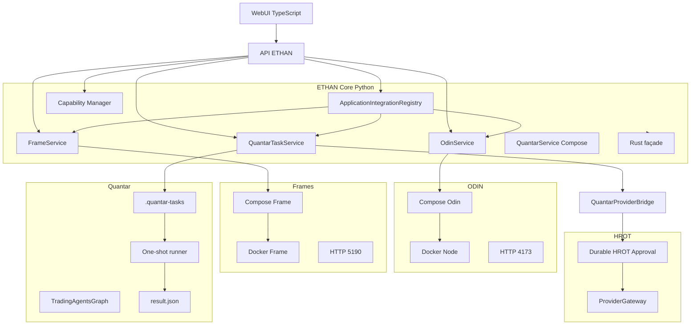
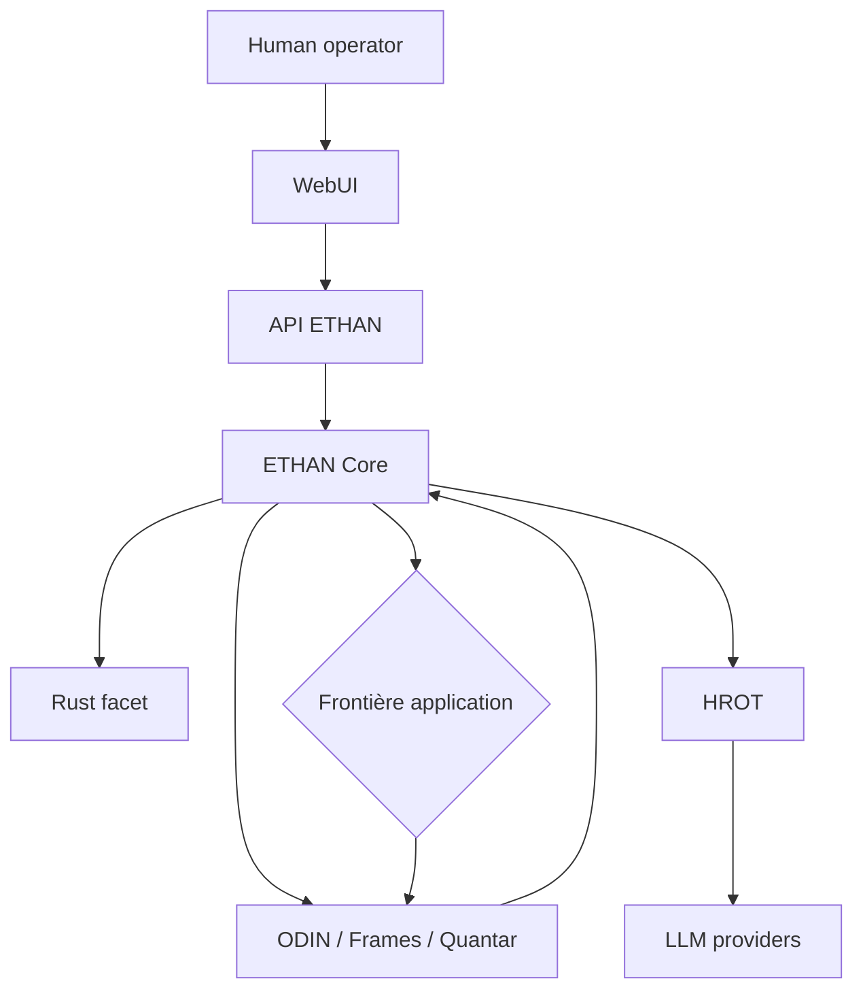
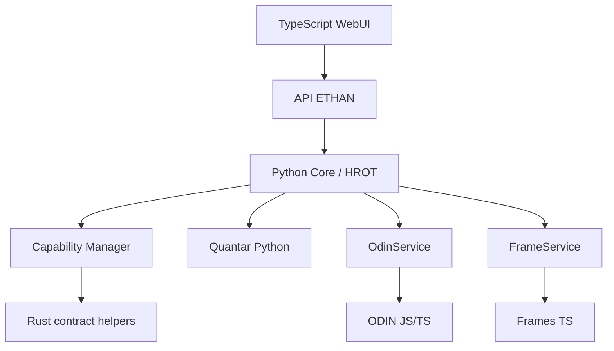
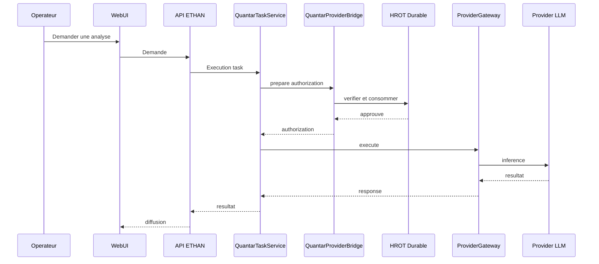
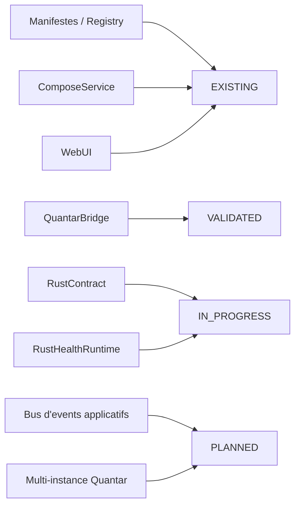

# ETHAN — Architecture cible des applications

Date : 2026-11-04
Statut : ARCHITECTURE CIBLE PROPOSÉE
Chemin demandé : `Obsidian/Architecture/Applications/ETHAN_APPLICATION_TARGET_ARCHITECTURE.md`

Cette architecture cible complète et précise la conception actuelle. Elle n'affirme pas qu'elle est déployée à l'identique.

## Légende des statuts

- `EXISTING` : présent dans le dépôt.
- `VALIDATED` : observé ou testé dans le flux réel ou une suite traitant ce composant.
- `IN_PROGRESS` : partiellement implémenté ou en cours de qualification.
- `PLANNED` : spécifié mais pas encore implémenté.
- `OPTIONAL` : facultatif pour le fonctionnement d'ETHAN Core.

---

## 1. Responsabilités cibles

| Composant | Responsabilité cible | Statut |
|---|---|---|
| ETHAN Core (Python) | gouvernance applicative, manifestes, cycles de vie, orchestration et état source de vérité | EXISTING / VALIDATED |
| HROT / HumanRoot | autorité humaine et décisions d'autorisation durables | EXISTING |
| Interfaces WebUI / CLI / desktop | affichage, paramétrage, déclenchement et supervision | EXISTING |
| ODIN | intelligence géospatiale temps réel, service permanent Node | EXISTING / INDEPENDENT |
| Frames / base HyperFrames | création et rendu vidéo, service permanent Bun/Vite | EXISTING / INDEPENDENT |
| Quantar | analyse de recherche financière, service Python one-shot | EXISTING / INDEPENDENT |
| ComposeService | gestion générique des services Docker réellement confiés | EXISTING / VALIDATED |
| OdinService et contrôleurs spécifiques | contrôle Docker indépendant d'Odin | EXISTING |
| Provider Gateway HROT | accès contrôlé aux providers LLM | EXISTING / VALIDATED sur bridge Quantar |
| Capability Manager | catalogue des capacités et installation sur demande | EXISTING |
| Rust spécialisés | validation de contrats et détection d'environnements isolés | EXISTING / PARTIELLEMENT QUALIFIÉ |
| TypeScript WebUI | interfaces et visualisation | EXISTING |
| Stockage | séparation tâches, manifestes, mémoire et événements | EXISTING / PLANNED selon les domaines |

---

## 2. Principes cibles

1. ETHAN Core demeure source de vérité pour l'identité, les autorisations, les manifestes et les cycles de vie.
2. Les applications restent autonomes pour leur logique métier, leur runtime et leur stockage interne.
3. Odin garde son contrôleur Docker spécifique.
4. Frames et le runtime autonome de Quantar peuvent utiliser `ComposeService`, sans universalisation imposée.
5. Quantar reste une exécution one-shot avec réconciliation.
6. Python demeure dominant pour l'IA, les agents et les dépendances amont.
7. Rust n'est utilisé que pour des composants spécialisés sous façade explicite.
8. Les interfaces TypeScript/Vite servent exclusivement à l'interaction et à l'affichage.
9. Aucune écriture provider ne se fait sans autorisation HROT explicite.
10. Aucune capacité installée n'est réputée opérationnelle sans vérification réelle.

---

## 3. Contrats d'intégration applicative cible

### 3.1 Identité applicative

Réutiliser `ethan-application-manifest.yaml` et l'enregistrement dans `ApplicationIntegrationRegistry`.

| Champ cible | Signification | Source actuelle |
|---|---|---|
| `app_id` | identifiant stable | manifeste |
| `instance_id` | instance déployée | manifeste |
| `name`, `version`, `publisher` | métadonnées de provenance | manifeste |
| `contract_version` | version du contrat applicatif | manifeste |
| `capabilities` | capacités déclarées | manifeste |
| `dependencies` | dépendances déclarées | manifeste |
| `interfaces.http` | entrée HTTP locale | manifeste |
| `interfaces.api` | API locale | manifeste |
| `permissions` | permissions applicatives minimales | manifeste |

### 3.2 Contrat de capacités applicatives

- capacités standardisées ;
- préremplissage possible par le manifeste ;
- validation au moment de l'enregistrement ;
- capacité manquante = enregistrement refusé ;
- capacité observée seulement = `AVAILABLE`, `VERIFIED` ou `INTEGRATED`, jamais `READY` sans preuve.

### 3.3 Autorisations

| Opération | Mode cible | Contrat existant |
|---|---|---|
| lecture statue / logs / santé | `Permission.READ` | route API |
| contrôle start / stop / restart | `Permission.PLUGINS` | route API |
| exécution provider LLM par Quantar | autorisation HROT durable + gateway | `QuantarProviderBridge` |
| permissions HROT dédiées à Odin et Frames | en attente de preuve | **PLANNED** |

### 3.4 Cycle de vie

États cibles :
- `not_installed`
- `installed_stopped`
- `starting`
- `running`
- `degraded`
- `stopping`
- `error`
- `unknown`
- pour Quantar tasks : `completed`, `failed`, `cancelled`, `interrupted`, `reconciling`

Actions autorisées :
- `start`
- `stop`
- `restart`
- `status`
- `logs`
- `health`
- pour Quantar : `prepare`, `run`, `cancel`, `reconcile`

### 3.5 Communication et événements inter-applications

- Communication directe uniquement via API HTTP documentée ou service interne du Core.
- Pas de traité d'inter-application non médiatisé.
- HROT reçoit toujours les autorisations provider.
- Événements applicatifs journalisés et traçables.
- Une application ne doit pas devenir source de vérité pour les autres.

### 3.6 Erreurs

Contrat cible uniforme :
- `code`
- `message` rédigé
- `details` optionnels
- `correlation_id`
- `timestamp`
- `state` associé

### 3.7 Observabilité

- logs redactés ;
- `get_health` et santé HTTP pour ODIN et Frames ;
- santé Docker/réconciliation pour Quantar ;
- tests documentés et exécutés ;
- état réel plutôt qu'état déclaré.

---

## 4. Architecture globale

---

## 5. Frontières de confiance

Frontières cibles :
- Core est la seule autorité sur l'identité, les permissions et les contrats.
- Les applications peuvent lire et exécuter leurs données, mais ne changent pas la politique.
- Rust n'a pas d'autorité d'accès.
- Les providers LLM ne sont accessibles que via gateway avec HROT.

---

## 6. Flux de communication

### ODIN et Frames
WebUI -> API -> service dédié -> Docker Compose figé -> application locale -> HTTP health.

### Quantar
WebUI -> API -> `QuantarTaskService` -> persistance locale + one-shot conteneur -> résultat fichier -> réconciliation -> API.

### HROT Quantar
`tâche` -> `QuantarProviderBridge` -> approval HROT -> `ProviderGateway` -> provider.

---

## 7. Architecture hybride Python / Rust / TypeScript

- **Python** : Core, HROT, agents, IA, orchestration, Quantar et logique applicative.
- **TypeScript** : WebUI et surfaces d'interaction.
- **Rust** : validation JSON de contrats, détection d'environnements isolés, et ultérieurement diagnostics spécialisés sous façade.
- **TypeScript/Native ODIN+HyperFrames** : logique frontend et proxies indépendants.

---

## 8. Cycle de vie des applications cible

### ODIN
1. manifeste enregistré,
2. service initialisé,
3. état réel inspecté,
4. démarrage contrôlé,
5. arrêt,
6. tests de santé.

### Frames
Même cycle, port 5190, image préconstruite.

### Quantar
1. enregistrement,
2. création de tâche,
3. préparation,
4. exécution in-process ou Docker,
5. persistance,
6. réconciliation au redémarrage,
7. invalidation en cas de crash.

---

## 9. Flux HROT

---

## 10. Stockage cible

| Domaine | Lieu conceptuel | Statut |
|---|---|---|
| manifestes applicatifs | `ApplicationIntegrationRegistry` | EXISTING |
| état tâche Quantar | workspace local `state.json` | EXISTING |
| résultats Quantar | `result.json` | EXISTING |
| journaux applicatifs | sources redactées | EXISTING |
| capacité de noyau et environnements | runtime ETHAN | EXISTING |
| modèles IA et mémoire | stockage dédié Core | PLANNED / EXISTING selon domaine |
| événements inter-applications | bus/registry médiatisé | PLANNED |
| donnéees volumineuses ODIN et Frames | dépôt et conteneurs | EXISTING |

---

## 11. Diagramme de statut by composant

---

## 12. ADR associé

Cet objectif est précisé dans ADR-4009 créé dans cette mission.

Aucun ADR existant n'a été renuméroté.

---

## 13. Conclusion

L'architecture cible conserve l'existant et l'enrichit par des contrats, des frontières et de l'observabilité. Elle n'impose ni migration de langage, ni universalisation des contrôleurs, ni dépendance facultative obligatoire.
