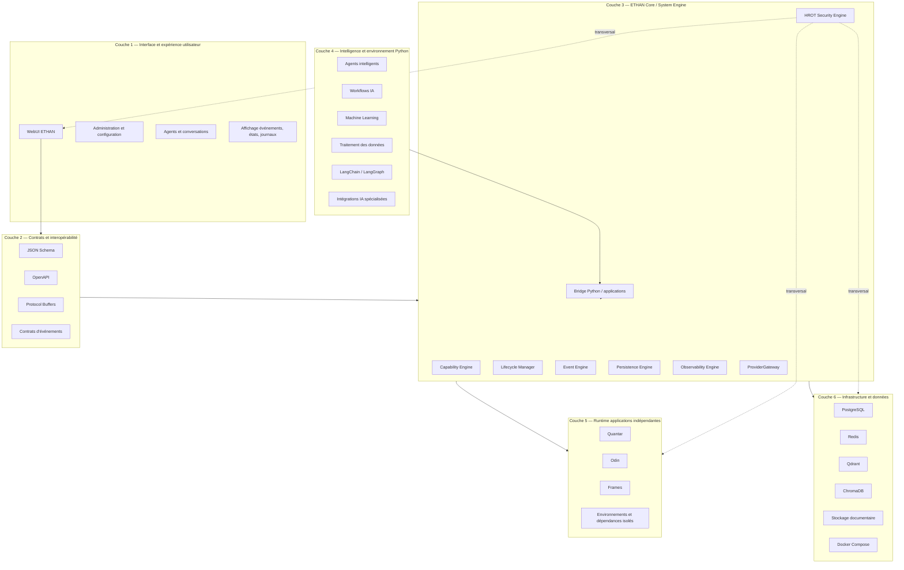
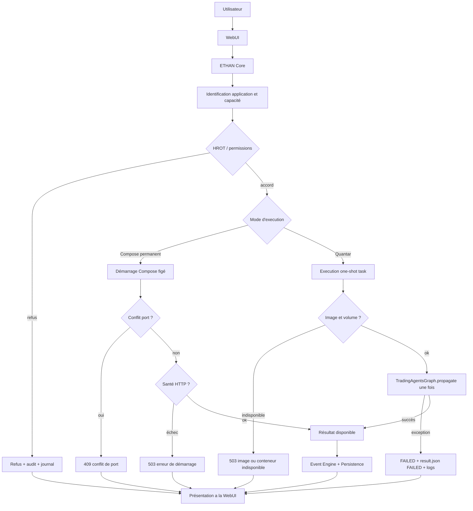

# ETHAN — Vision architecturale cible

**Statut** : RÉFÉRENCE CIBLE (orientation long terme approuvée par l'opérateur)
**Date** : 2026-11-04
**Nature** : dossier d'architecture système, reconnu comme référence pour toute évolution structurante
**Emplacement canonique** : `Obsidian/Architecture/ETHAN_ARCHITECTURE_VISION.md`

> Ce document n'annule pas `Obsidian/Architecture/System/ARCHITECTURE-CIBLE.md`, qui reste la référence opposable de l'architecture actuellement implémentée. Il exprime la cible de plus long terme et distingue explicitement existant, migration et cible.

---

## 1. Architecture générale

ETHAN est un système d'IA modulaire dont les capacités métier appartiennent au Core et au Runtime. Les interfaces révèlent ETHAN sans le définir. La vision cible conserve la Première Loi d'ETHAN tout en introduisant une répartition multilangage et des applications réellement indépendantes.

### Couche 1 — Interface et expérience utilisateur

**Technologie principale : TypeScript / React / Next.js**

Responsabilités :
- WebUI ETHAN.
- Gestion des agents et des conversations.
- Administration et configuration.
- Gestion des capacités.
- Interface des applications intégrées.
- Affichage des événements, états et journaux.
- Communication avec les API ETHAN.

La WebUI ne doit pas porter les responsabilités de sécurité, d'autorisation ou de décision du Core. Elle consomme des contrats et présente un état qu'elle ne possède pas.

### Couche 2 — Contrats et interopérabilité

Technologies selon les besoins :
- JSON Schema.
- OpenAPI.
- Protocol Buffers.
- Contrats d'événements.

Responsabilités :
- Définir les interfaces communes entre Rust, Python et TypeScript.
- Normaliser les échanges entre ETHAN Core et les applications.
- Définir les structures de données et les états.
- Garantir la compatibilité des versions.
- Permettre l'intégration de nouveaux langages sans réécrire le Core.

Toute nouvelle application doit être intégrée par contrats explicites, pas par accès direct aux structures internes.

### Couche 3 — ETHAN Core / System Engine

**Technologie principale : Rust**

Le Core constitue le moteur système central. Le Rust doit progressivement prendre en charge les responsabilités système actuellement implémentées en Python, sans migration brutale et derrière des contrats testables.

Responsabilités détaillées :

- **Capability Engine** : découvre, détecte, installe, configure, teste, active et désactive les capacités. Il centralise la notion de `supported ≠ installed ≠ running ≠ ready`.
- **HROT Security Engine** : identité, permissions, autorisations, approbations humaines, isolation et refus par défaut.
- **Lifecycle Manager** : gère le cycle de vie des composants, applications et dépendances. Il ne lance pas automatiquement des applications sans décision ni permission.
- **Event Engine** : produit, reçoit, distribue et persiste les événements système, applicatifs, de sécurité et liés aux agents.
- **Persistence Engine** : persistance atomique et typée des états système, journaux, événements et données de provenance.
- **Observability Engine** : traces, métriques, journaux et provenance.
- **ProviderGateway** : accès contrôlé et auditables aux fournisseurs LLM et services externes, uniquement sous autorisation HROT.
- **Communication avec les environnements Python et les applications autonomes** : via contrats, pas via partage implicite de mémoire ou d'état.


### Couche 4 — Intelligence et environnement Python

**Technologie principale : Python**

Responsabilités :
- Agents intelligents.
- Exécution des workflows IA.
- Machine Learning.
- Traitement des données.
- LangChain et LangGraph.
- Bibliothèques scientifiques.
- Intégrations IA spécialisées.

Les environnements Python doivent être isolés et indépendants. LangChain, LangGraph, ChromaDB et autres capacités doivent rester optionnels et activables uniquement lorsque nécessaires. Un framework IA ne devient pas une dépendance obligatoire du Core sans justification explicite.

### Couche 5 — Runtime des applications indépendantes

Les applications ne sont pas de simples modules du Core. Chacune peut disposer :
- De son propre environnement.
- De ses dépendances.
- De son propre runtime.
- De sa configuration.
- De ses journaux.
- De son cycle de vie.
- De ses permissions et exigences de sécurité.

Exemples :
- Quantar : worker d'analyse quantitative.
- Odin : contrôleur Docker indépendant.
- Frames : service intégré au Core via ComposeService.

ETHAN supervise et autorise ces applications sans imposer un runtime universel. Une application doit pouvoir continuer avec ses propres ressources si ETHAN est inaccessible, et ETHAN doit pouvoir superviser l'application sans en absorber le moteur.

### Couche 6 — Infrastructure et données

Responsabilités et usages :

- **PostgreSQL** : données relationnelles, transactions et persistance.
- **Redis** : cache et coordination lorsque nécessaire.
- **Qdrant** : mémoire vectorielle.
- **ChromaDB** : stockage vectoriel alternatif.
- **Stockage documentaire** : documents, fichiers et connaissances.
- **Docker Compose** : environnements isolés des applications.

Aucune technologie ne doit devenir obligatoire sans justification architecturale. L'absence d'une technologie ne doit pas empêcher ETHAN de fonctionner dès lors qu'elle est déclarée optionnelle et contournée proprement.

---

## 2. Diagramme architectural obligatoire



Le diagramme montre :
- le passage UI vers Core uniquement par contrats ;
- les responsabilités internes Rust du Core ;
- les interactions avec Python ;
- les applications autonomes ;
- l'infrastructure de données ;
- le rôle transversal de HROT.


---

## 3. Diagramme des flux d'exécution



Ce flux fait apparaître les refus et erreurs possibles :
- refus d'autorisation ;
- conflit de port ;
- échec de santé HTTP ;
- image ou conteneur indisponible ;
- exception d'exécution Quantar.

---

## 4. Architecture événementielle

L'architecture cible est événementielle. Les modules ne s'appellent pas directement par dépendance implicite. Ils produisent et consomment des événements typés, persistés et auditables.

### Types d'événements

- Événements système : démarrage, arrêt, santé, capacité installée, capacité désactivée, migration, configuration.
- Événements applicatifs : lancement d'application, arrêt, tâche créée, tâche terminée, résultat produit.
- Événements de sécurité : refus d'autorisation, élévation refusée, secret manquant, tentative non autorisée, incident HROT.
- Événements liés aux agents : agent activé, outil appelé, mémoire modifiée, tâche déléguée, erreur d'exécution.

### Contrat commun minimal

Chaque événement doit inclure au moins les champs suivants :
`event_id`, `app_id`, `instance_id`, `timestamp`, `event_type`, `operation`, `status`, `provenance`, `evidence_refs`.

Exemple de forme :

```json
{
  "event_id": "evt-...",
  "app_id": "quantar",
  "instance_id": "quantar-local-default",
  "timestamp": "2026-11-04T00:00:00Z",
  "event_type": "task.completed",
  "operation": "propagate",
  "status": "completed",
  "provenance": "TradingAgentsGraph",
  "evidence_refs": ["result.json"]
}
```

### Persistance, provenance et reprise

- L'Event Engine persiste les événements dans le backend durable approprié.
- Chaque événement conserve son auteur logique, sa source, son horodatage et ses références de preuves.
- Les événements de sécurité sont append-only pour la traçabilité.
- La provenance distingue observations, déductions, hypothèses et preuves.
- En cas d'incident :
  - ETHAN conserve les événements déjà persistés ;
  - une application peut être redémarrée indépendamment ;
  - la reconciliation reprend les états incohérents ;
  - les événements critiques sont rejouables ou réconciliables selon leur type.
- Aucun événement ne doit être silencieusement supprimé pour masquer une erreur.

---

## 5. Architecture mémoire

La mémoire de ETHAN est hybride et volontairement différenciée.

| Niveau | Rôle | Technologies possibles | Relations |
|---|---|---|---|
| **Opérationnelle** | État courant, statuts, tâches, capacité présente | PostgreSQL, Redis, records typés | alimentée par les événements système |
| **Conversationnelle** | Historique et contexte d'usage | stockage persistant + vectorisation | alimente le RAG et les agents |
| **Documentaire** | Documents, fichiers, connaissances et sources | stockage documentaire, indices | référencée par les agents et le RAG |
| **Technique** | Architecture, ADR, mémoire d'engineering, procédures | Obsidian, Markdown, ADR | guide les agents et les développeurs |
| **Vectorielle** | recherche sémantique et similarité | Qdrant, ChromaDB, PostgreSQL vectoriel | dérivée des mémoires précédentes |
| **Événementielle** | historique complet de ce qui s'est passé | Event Engine persisté | source de vérité historique et d'audit |

Principes :
- chaque niveau a un propriétaire et une durée de vie ;
- la mémoire technique ne remplace jamais les archives ni les preuves ;
- la mémoire vectorielle est une capacité dérivée et optionnelle ;
- aucune mémoire ne doit devenir source de vérité implicite hors contrat.

## 6. Sécurité et HROT

### Human Root of Trust

HROT est l'autorité centrale de ETHAN. Il conserve :
- l'identité ;
- l'authentification ;
- l'autorisation ;
- les permissions contextuelles ;
- la gestion des secrets ;
- l'approbation humaine ;
- la traçabilité ;
- le refus par défaut.

Aucun agent, framework, application ou module ne peut s'accorder ses propres permissions. Une capacité non autorisée est refusée, même si elle est techniquement disponible.

### Isolement et contrôle

- Les applications sont isolées selon leurs environnements et leurs permissions.
- Les commandes d'infrastructure sont figées et confinées (pas de shell arbitraire).
- Les secrets sont redactés dans les logs et ne sont jamais persistés dans la documentation.
- Les fournisseurs LLM ne sont accessibles que via ProviderGateway et, pour les applications sensibles, via une autorisation durable HROT.
- Les capacités optionnelles sont détectées et activées explicitement.
- L'approbation humaine est requise pour les actions à impact : démarrage contrôlé, changement de configuration critique, autorisation provider, dépendance à un service externe.

---

## 7. Principes de conception non négociables

1. Rust pour le système, Python pour l'intelligence, TypeScript pour les interfaces.
2. Interopérabilité par contrats explicites.
3. Applications indépendantes.
4. Architecture événementielle.
5. HROT comme autorité de confiance.
6. Mémoire hybride.
7. Capacités optionnelles et activables à la demande.
8. Migration progressive sans rupture.
9. Absence de dépendance obligatoire à un framework IA.
10. Pas de runtime universel imposé à toutes les applications.

Ces principes priment sur les préférences d'implémentation locales.

## 8. État de réalisation

Ne jamais présenter une architecture cible comme une fonctionnalité déjà disponible. Les composants ci-dessous indiquent leur statut réel dans le dépôt actuel.

| Composant | Statut | Observation |
|---|---|---|
| Première Loi d'ETHAN (Core/Runtime source de vérité) | EXISTING | AGENTS.md et Core déjà établis |
| WebUI TypeScript | EXISTING | `interfaces/webui` |
| API passerelle mince | EXISTING | `interfaces/api` |
| Capability Manager | EXISTING | `core/capability_manager` |
| Auth / groupes / permissions | EXISTING | `core/auth` |
| HROT provider gateway | EXISTING | `core/security/hrot_provider_gateway.py` |
| Event store Rust | IN_PROGRESS / shadow | `core/bus/backends/rust_event_store` |
| Core applicatif Rust | PLANNED | pas encore source de vérité métier |
| Applications indépendantes Compose | EXISTING | Odin, Frames, Quantar |
| Application Quantar HROT bridge | EXISTING | `core/applications/quantar_provider_bridge.py` |
| Application registry | EXISTING | `core/applications/application_registry.py` |
| LangChain / LangGraph | OPTIONAL | dépend des composants et environnements |
| ChromaDB | OPTIONAL | alternative vectorielle |
| Qdrant | OPTIONAL | alternative vectorielle |
| Memory vectorielle pour toutes les apps | PROPOSED | convergence non tranchée |
| Runtime universel partagé | PROPOSED | explicitement rejeté comme principe |

---

## 9. Exploitabilité par les agents

Un agent doit pouvoir utiliser ce document pour :

- comprendre l'organisation d'ETHAN ;
- identifier si une capacité appartient au Core ou à une interface ;
- choisir le bon langage et la bonne couche ;
- identifier le composant à modifier ;
- respecter les frontières de sécurité ;
- identifier les contrats à respecter ;
- éviter de créer des composants redondants ;
- proposer des évolutions compatibles avec la cible.

Ordre de consultation recommandé :
1. `core/`, `runtime/` conceptuel et services réels pour vérifier l'existant.
2. `Obsidian/Architecture/ETHAN_ARCHITECTURE_VISION.md`.
3. `Obsidian/Architecture/System/ARCHITECTURE-CIBLE.md`.
4. les ADR et ESR existants.
5. `Obsidian/Architecture/APP_TECHNICAL_CARTOGRAPHY.md` pour les applications indépendantes.

Règle anti-redondance : avant de créer un nouveau composant, vérifier s'il existe déjà dans le Core, le Runtime, les services ou les plugins.

---

## 10. Intégration dans Obsidian et documentation associée

- Respecte l'organisation actuelle d'Obsidian.
- Ajoute les liens nécessaires sans créer d'index parallèle.
- Ne duplique pas les décisions déjà documentées.
- Ne supprime ni ne déplace aucun fichier.
- Ne modifie pas le code ETHAN.
- Ne crée pas un second système documentaire.

Liens associés :
- [ARCHITECTURE-CIBLE.md](System/ARCHITECTURE-CIBLE.md)
- [README_ARCHITECTURE_REFERENCE.md](System/README_ARCHITECTURE_REFERENCE.md)
- [ADR-4006 — rebuild cible hybride](ADR/ADR-4006-rebuild-target-architecture.md)
- [ADR-4008 — shadow mode Rust event store](ADR/ADR-4008-rust-event-store-shadow-mode.md)
- [ADR-4005 — modèle de confiance des extensions](ADR/ADR-4005-extension-trust-model.md)
- [Proposition Rust/Python](../_meta/MEM_013_RUST_PYTHON_ARCHITECTURE_PROPOSAL.md)
- [Cartographie technique ODIN / Frames / Quantar](APP_TECHNICAL_CARTOGRAPHY.md)
- [Index Obsidian](../INDEX.md)
