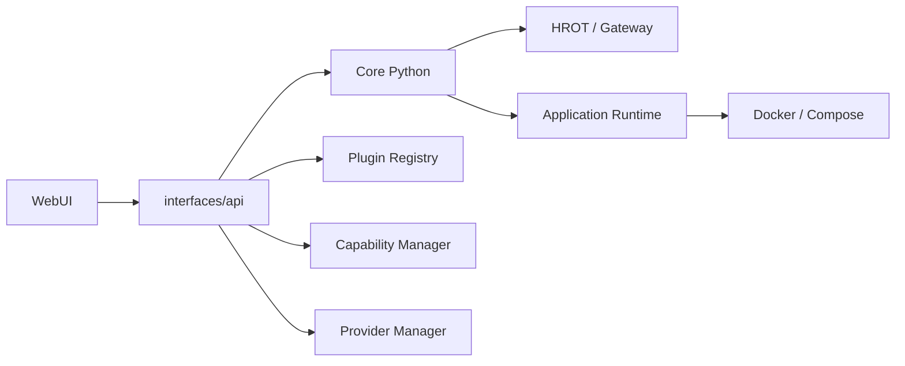

# 00 — Executive Summary

Mission 19 — Audit global ETHAN / WebUI (statut : audit uniquement).

## État global observé

- ETHAN n'est pas une application WebUI centralisée : c'est un Core Python avec plusieurs interfaces (API, WebUI, CLI, Desktop, etc.). WebUI est un client.
- Des routes backend sont enregistrées pour la plupart des menus (`capabilities`, `plugins`, `providers`, `knowledge`, `frame`, `odin`, `quantar`, `skills`, `extensions`, `component_lifecycle`) dans `interfaces/api/main.py`.
- Un mécanisme d’application discovery existe : `core/applications/discovery.py` ne crée que des capacités `DECLARED`; il ne prouve ni disponibilité ni exécution.
- Des services par application (`core.plugins.odin`, `core.plugins.frame`, `quantar`) sont disponibles comme passerelles HTTP minces.
- Le Provider Manager (`core/llm/provider_manager.py`) est le gestionnaire canonique des providers LLM. Ollama est natif, sans secret.
- Le Provider Gateway HROT (`core/security/hrot_provider_gateway.py`) est textuel et n’est pas utilisé opérationnellement (phase 47 précédente).
- Aucune preuve contradictoire n’a été observée sur la simple présence de routes.

## Éléments confirmés par le code

- API inclut bien les routers pour plugins, capabilities, providers, knowledge, odin, frame, quantar, skills (`interfaces/api/main.py`, observation code).
- Plugins router expose install/enable/disable/uninstall/connect, avec permission `PLUGINS` et `gateway_guard(ActionType.PLUGIN_INSTALL)` pour `/plugins/install`.
- Provider Manager persiste les configs sans clé, garde les clés en mémoire, expose catalogue et chat.
- Application registry maintient une distinction registered/validated/available/unavailable et un état lifecycle distinct.
- Discovery crée des objets `DECLARED`, sans prétendre vérifier Docker.

## Partial / bloqué / non vérifié

- Installation plugins/capabilities réelle : non testée (contrainte mission), donc le point exact de rupture est confirmé conceptuellement via gardes de permission, mais pas démontré bout-en-bout.
- États application : `available` persisté peut ne pas correspondre au conteneur réel ; non confirmé par exécution.
- ODIN/Frame : services exposés, mais état Docker réel non modifié pendant cette mission.
- Knowledge search/index : routes présentes, détail d’implémentation réel partiellement non inspecté dans le temps imparti.
- HROT : contrôleurs backend présents, approvals UI; couverture réelle insuffisamment vérifiée.

## Problèmes probables

- WebUI peut afficher des éléments découverts/registered même si Docker/image/service n’est pas réellement disponible.
- Plusieurs gestionnaires parallèles (`application_registry`, component_lifecycle, plugins service, ODIN, Frame, Quantar) peuvent exposer des statuts divergents.
- Plugins installation sensible aux permissions HROT `PLUGINS`, à la présence du registre, à la garde frontend/backend, et aux formats de données frontend.
- Routes/API et types TS/Pydantic peuvent diverger ; non exhaustivement testé aujourd’hui.

