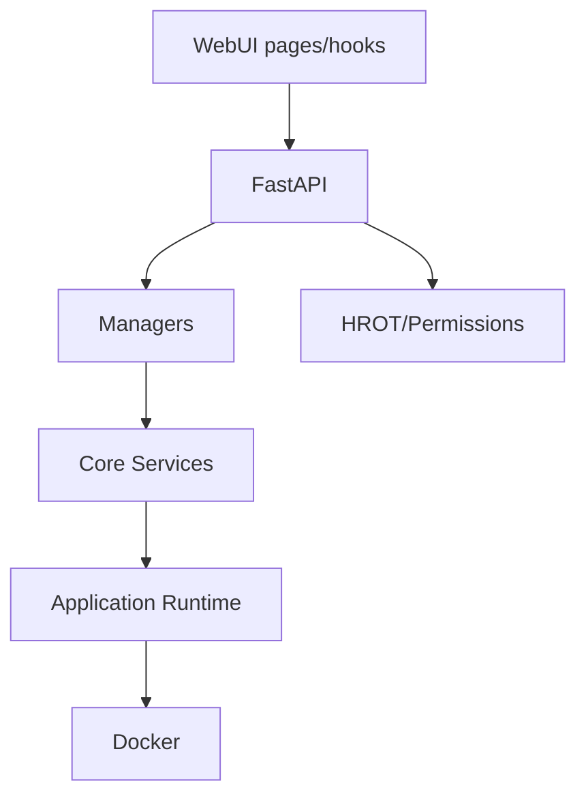

# 03 — Component Dependencies

## Relations vérifiées

- WebUI → `lib/api/*` → FastAPI routers.
- FastAPI `main.py` monte les routers sous préfixes `/v1` ou `/v1/plugins`.
- Plugin router → inject `core.plugins.PluginRegistry` au démarrage (fallback `get_plugin_registry()`).
- Capability router → Capability Manager / Component Lifecycle.
- Application registry → manifests, compliance, permission service, event collector, lifecycle manager, state store.
- ODIN/Frame/Quantar APIs → `core.plugins.*` services.
- Provider Manager → ProviderStore, LLMProviderRegistry, LLMClient.
- Provider Gateway → SecretProvider, adapters, authorizations, HROT durable optionnel.

## Chaînes canoniques

## Risques de dépendance

- Plusieurs états parallèles pour applications : registry, lifecycle, Docker image, compose.
- Menu Tools peut afficher des applications découvertes sans runtime réel.
- Plugin install est dépendant de la permission backend, pas seulement UI.
