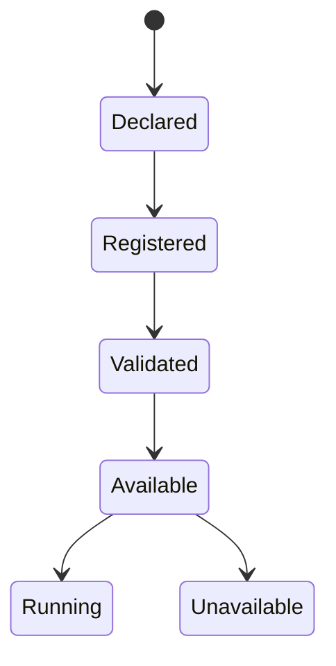

# 04 — Application Lifecycle

## États distincts observés

- `DECLARED` : manifest découvert, pas de vérification.
- `REGISTERED` : application enregistrée dans le registry.
- `VALIDATED` : manifest/compliance évalué.
- `AVAILABLE` / `UNAVAILABLE` : disponibilité enregistrée.
- `RUNNING`, etc. via `ApplicationLifecycleManager`.

## Pourquoi ODIN/Framework/Quantar peuvent apparaître sans lancement manuel

Hypothèse confirmée par architecture : l’application registry et la découverte de manifests peuvent rendre visibles des instances sans conteneur démarré. L’étatpersisté/réseau discovery n’est pas une preuve de conteneur démarré. De plus, services préexistants ou proxy peuvent servir UI même sans commande compose.

## Recommandation

- Séparer rigidement `declared`, `registered`, `docker_image_available`, `container_started`, `service_reachable`.
- Ne pas utiliser `available` comme synonyme d’exécution.
