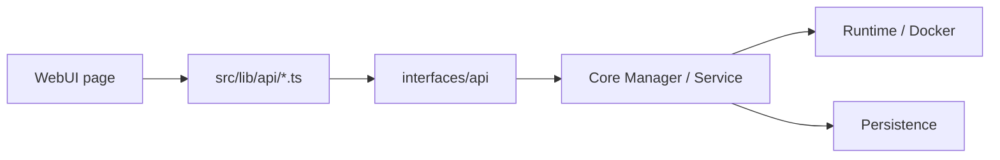

# ETHAN — Functional Map (WebUI ↔ Core)

Statut : audit uniquement, pas de modification.

## 1. Architecture réelle et points d'entrée

- WebUI Next.js : `interfaces/webui/src/`
- API FastAPI : `interfaces/api/main.py` monte les routers :
  - `capabilities`, `plugins`, `providers`, `knowledge`, `odin`, `frame`, `quantar`, `skills`, `extensions`, `component_lifecycle`
- Core Python : `core/...` (managers/registries/services)
- Applications : `core/applications/application_registry.py`, `core/applications/discovery.py`, intégrations ODIN/Frame/Quantar

## 2. Chaînes fonctionnelles

- Applications visibles via discovery/register may precede Docker start.
- Plugin/Tools UI states should be derived from backend status, not static lists.

## 3. Fonctionnalités opérationnelles observées

| Fonction | WebUI | API | Core | État vérifié |
|---|---|---|---|---|
| Plugins liste/detail | `src/app/plugins`, `lib/api/plugins.ts` | `/v1/plugins` | `core.plugins.PluginRegistry` | partiel |
| Plugin install | UI install action | `/v1/plugins/install`, permissions `PLUGINS`, `gateway_guard` | PluginRegistry install | partiel |
| Providers | `src/app/providers`, `lib/api/providers.ts` | `/v1/providers` | `core/llm/provider_manager.py` | partiel |
| Knowledge | `src/app/knowledge`, `lib/api/knowledge.ts` | `/v1/knowledge*` | core knowledge managers | partiel |
| ODIN/Frame/Quantar | `src/app/odin`, `frame`, `quantar` | `/v1/plugins/odin`, `/v1/plugins/frame`, quantar routers | `core.plugins.odin`, `frame`, quantar services | endpoints présents |
| Quantar status/config | page quantar | `/v1/quantar/status`, `/config` | Quantar service | observable |

## 4. Applications : séparation d'état

- `Discovery` crée `DECLARED`, pas vérifié.
- `ApplicationRegistry` maintient registered/validated/available/unavailable + lifecycle.
- Docker state should be checked separately via image/container/service.
- Consequence: menus Tools can show declared items before real runtime.

## 5. Permissions HROT

- `require_permission(...)` visible on routers.
- Plugin install also uses `gateway_guard(ActionType.PLUGIN_INSTALL)`.
- Provider secrets stored in-memory in Provider Manager, not persisted.
- No secrets provided to workers/containers.

## 6. Contrats et ruptures

- `capabilities.ts` frontend file in this repo mostly calendar/notes and may not correspond to capabilities router semantics ; naming mismatch to investigate.
- Multiple parallel state systems (`application_registry`, `component_lifecycle`, runtime) can diverge.
- States labels must be mapped explicitly (`registered` vs `running`).

## 7. Trois principales ruptures

1. L'état applicatif enregistré (`available`) n'est pas une preuve Docker/service reachable.
2. Les chaînes d'install plugin/capability dépendent de permissions/guards et de registry init ; la propagation d'erreurs doit rester alignée.
3. Les menus UI agrègents plusieurs sources et états sans discipline de typage suffisante.

## 8. Éléments non vérifiés

- runtime execution test
- TypeScript ↔ Pydantic contract diff
- end-to-end install
- component lifecycle backend implementation location
