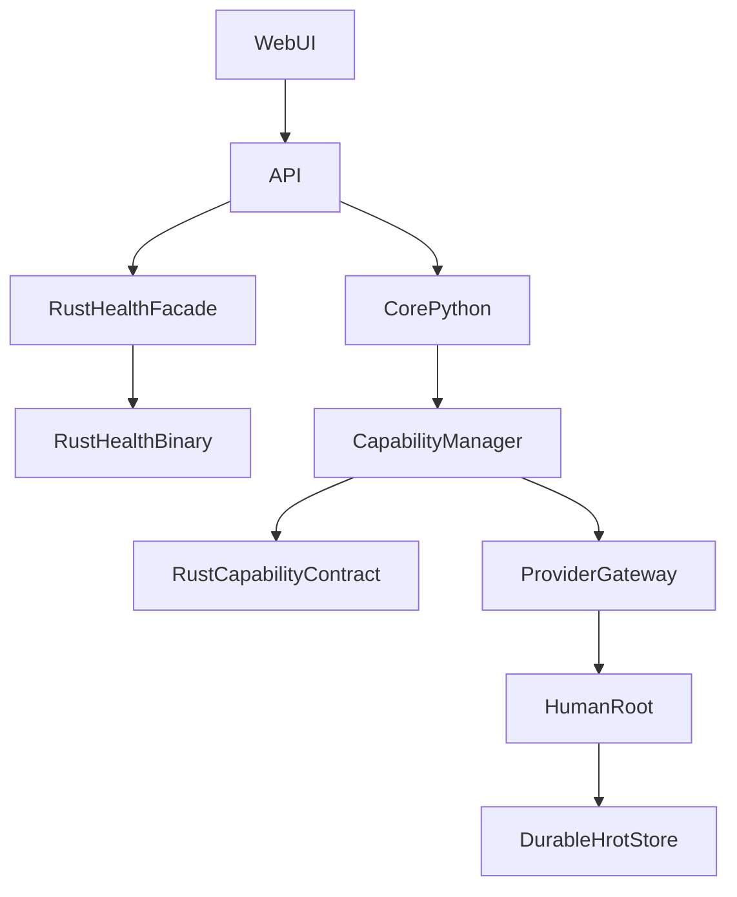

# Architecture hybride Python / Rust d ETHAN

Date : 2026-11-04
Statut : decisions confirmees, sauf validations Docker/runtime restantes

## 1. Decisions confirmees

1. Python reste la source de verite pour HROT et la logique metier.
2. Rust realise des responsabilites specialisees et isolees.
3. Les integrations Rust passent par des facades et contrats explicites.
4. Capability Manager conserve son autorite Python.
5. Rust Health est consomme par une facade Python et une route API protegee.
6. Les applications ODIN, HyperFrame et Quantar conservent leur independance technologique.

## 2. Diagramme Mermaid

## 3. Elements valides

- contrats JSON Python/Rust
- detection d environnements
- bridge provider HROT (tests unitaires)
- entree API /v1/health/rust au niveau source

## 4. Elements restant à qualifier

- Docker rebuild API avec Health bundlé
- validation navigateur WebUI
- integration HROT durable
- multi-instance et concurrence reelles

## 5. Mapping ODIN / HyperFrame / Quantar

- ODIN : contrôle HTTP compose et events
- HyperFrame : application in-process
- Quantar : runtime one-shot conteneur
