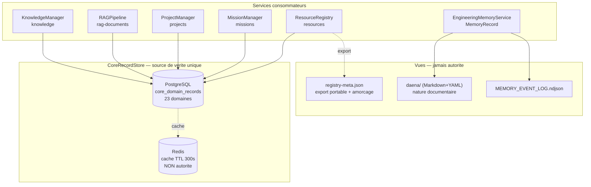

# DAĒNĀ P2.8.1 — Architecture de persistance unifiée

> Unification de la persistance des connaissances et de la mémoire
> d'ingénierie dans ETHAN Core. **Aucune nouvelle base, aucun nouveau moteur
> de stockage** : la stratégie repose sur le `CoreRecordStore` existant.

**Statut :** IMPLEMENTED · TESTED
**Prérequis :** P2.8.0 validée (correspondance des catégories documentaires)
**Phase :** DAĒNĀ P2.8.1 — Mission 02, Stabilisation fonctionnelle

---

## 1. Principe directeur

> **Une seule source de vérité par type de donnée, plusieurs services
> consommateurs, plusieurs interfaces.**

Chaque type de donnée a **un** stockage faisant autorité. Les autres
représentations sont des **vues** (exports, caches, index) et jamais des
autorités concurrentes.

---

## 2. Cartographie de la persistance

### 2.1 Avant P2.8.1

| Composant | Données | Stockage | Durabilité | Utilisateurs |
|---|---|---|---|---|
| `KnowledgeManager` | `KnowledgeNode` | `CoreRecordStore` → PG, domaine `knowledge` | **Oui** (runtime) | API, CLI, agents |
| `RAGPipeline` | `IngestedDocument` | `CoreRecordStore` → PG, domaine `rag-documents` | **Oui** (runtime) | API, CLI |
| `ProjectManager` | Projets | `CoreRecordStore` → PG, domaine `projects` | **Oui** (runtime) | API, WebUI |
| `MissionManager` | Missions, étapes | `CoreRecordStore` → PG, domaine `missions` | **Oui** (runtime) | API, agents |
| `EngineeringMemoryService` | `MemoryRecord` | **Fichiers** `daena/` (Markdown + YAML) | **Oui** | API, WebUI, agents |
| `ResourceRegistry` | `ResourceRecord` | **Fichier** `registry-meta.json` | Oui (fichier) | **aucun** (service orphelin) |
| `AuditStore` | `AuditEntry` | PG `audit_log` + `audit.jsonl` | Oui | approbations, HROT |
| `EngineeringMemoryService` | Journal d'audit | `daena/_meta/MEMORY_EVENT_LOG.ndjson` | Oui | lecture humaine |

### 2.2 Défauts constatés

| ID | Défaut | Preuve | Impact |
|---|---|---|---|
| **D1** | `ResourceRegistry` construit son `KnowledgeManager` **sans store** | `core/resources/registry.py` : `KnowledgeManager()` | Les 145 `KnowledgeNode` créés par P2.7 (métadonnée `knowledge_state: indexed`) ont disparu au redémarrage — **l'affirmation était fausse** |
| **D2** | `ResourceRegistry` utilise un stockage **fichier** hors `CoreRecordStore` | `registry-meta.json` | Persistance concurrente : invisible des autres services Core |
| **D3** | Le `RAGPipeline` utilisé par la découverte était également **sans store** | P2.7.1 | Les `rag_document_id` référencés n'existent nulle part |
| **D4** | Le fallback de `_load_from_persistence` **ignorait un chemin explicite** | `possible_paths` incluait `Path.cwd() / <name>` | Un registre de test chargeait silencieusement le registre global : persistance non déterministe |
| **D5** | `ResourceRecord.from_dict` **perdait `discovered_at` / `last_verified`** | `from_dict` ne les relisait pas | L'historique de découverte repartait à `now()` |
| **D6** | Double comptage des statuts dans `discover_skills` | bloc `status_counts[new_records[-1]...]` | Compteurs ×2 |
| **D7** | `_reconstitute_pending_nodes` n'était **jamais appelé** | aucun appelant | Les nœuds n'étaient jamais rattachés après rechargement |

### 2.3 Après P2.8.1

| Composant | Données | Stockage faisant autorité | Durabilité | Vues / caches |
|---|---|---|---|---|
| `KnowledgeManager` | `KnowledgeNode` | `core_domain_records[knowledge]` | PG | cache Redis (TTL 300 s) |
| `RAGPipeline` | `IngestedDocument` | `core_domain_records[rag-documents]` | PG | vecteurs : mémoire / ChromaDB / Qdrant |
| `ProjectManager` | Projets | `core_domain_records[projects]` | PG | — |
| `MissionManager` | Missions | `core_domain_records[missions]` | PG | — |
| `ResourceRegistry` | `ResourceRecord` | **`core_domain_records[resources]`** | PG | `registry-meta.json` = export portable + amorçage |
| `EngineeringMemoryService` | `MemoryRecord` | **Fichiers `daena/`** (nature documentaire) | disque | index `_meta/`, journal NDJSON |
| `AuditStore` | `AuditEntry` | PG `audit_log` + JSONL | PG / disque | ring buffer mémoire |

**Invariant retenu :** une donnée n'a qu'une authority. Le fichier
`registry-meta.json` est explicitement un **export** et un **amorçage**, plus
une autorité concurrente.

---

## 3. Architecture retenue

### 3.1 Principe : ne pas imposer une abstraction à des natures différentes

Le `CoreRecordStore` est réservé aux **enregistrements structurés**. Les
**documents** (Engineering Memory : `MemoryRecord` en Markdown + YAML) gardent
leur stockage fichier : ce sont des objets destinés à la lecture humaine, avec
métadonnées de gouvernance, pas des lignes de table.

Ce qui change n'est donc pas « tout dans PostgreSQL », mais **chaque donnée
dans son stockage naturel, avec une seule autorité par donnée**.

### 3.2 Le `ResourceRepository`

`core/resources/repository.py` — nouveau module, responsabilité unique :

```python
class ResourceRepository:
    def __init__(self, store: CoreRecordStore | None = None) -> None: ...
    async def save(self, record) -> None: ...
    async def save_all(self, records) -> int: ...
    async def get(self, stable_id) -> dict | None: ...
    async def load_all(self) -> list[dict]: ...
    async def delete(self, stable_id) -> bool: ...
    async def count(self) -> int: ...
    async def sync_from_records(self, records) -> dict[str, int]: ...
```

- Domaine : `resources` (convention des autres services Core).
- Sérialisation : `ResourceRecord.to_dict()` / `from_dict()` — **aucune
  logique métier** dans le repository.
- `save_all` est **idempotent** (upsert par `stable_id`).
- `sync_from_records` retire les entrées disparues **du seul domaine
  `resources`** ; il ne touche jamais un autre domaine.

### 3.3 Le `ResourceRegistry` unifié

```python
registry = ResourceRegistry(
    knowledge_manager=...,        # injecté, ou construit sur `store`
    store=domain_store,           # CoreRecordStore partagé (PG + Redis)
    registry_meta_path=...,        # amorçage / export
)
await registry.load_from_repository()   # relit la source de vérité
await registry.discover_documents(...) # découverte + cycle de vie
```

Points de contrat :

| Élément | Règle |
|---|---|
| `KnowledgeManager` | Construit sur `store` si non injecté → les nœuds sont **durables** |
| Écriture | `persist()` : `CoreRecordStore` (autorité) **puis** export fichier |
| Lecture | `load_from_repository()` : la source de vérité prend le pas sur l'amorçage |
| Chemin explicite | Fait foi : plus de fallback silencieux vers le registre global |
| Cycle de vie | `mark_stale` / `mark_disappeared` / `mark_deprecated` / `restore_resource` sont **async** et persistent via `persist()` |

### 3.4 Schéma



---

## 4. Contrat de persistance commun

| Aspect | Contrat |
|---|---|
| **Identité** | `stable_id` (UUIDv5) pour les ressources ; `node.id` aligné sur le `stable_id` pour les nœuds ; `id` métier (`EVT-…`, `CMP-…`) pour l'Engineering Memory |
| **Création / mise à jour** | Upsert par identifiant — jamais de duplication |
| **Lecture** | `get(id)` / `list(domain)` — pas de scan global hors domaine |
| **Suppression** | `delete(id)` explicite ; les transitions de cycle de vie ne suppriment pas, elles marquent |
| **Provenance** | `source_original` (ressources), `source` (nœuds), `source_of_fact` + `provenance_level` + `confidence` (EM) |
| **Métadonnées** | `ResourceMeta` sérialisé (`domain`, `level`, `version`, `author`, `confidence`, `tags`, `related_to`) + champs documentaires |
| **Relations** | `KnowledgeConnection` entre nœuds ; `related_to` dans les métadonnées de ressource ; `components[]` / `evidence_refs[]` en EM |
| **Transactions** | `CoreRecordStore.save` écrit d'abord la copie mémoire puis PostgreSQL ; l'échec PG laisse la mémoire cohérente et journalise l'erreur |
| **Erreurs** | Un enregistrement illisible est ignoré au chargement, journalisé, et n'interrompt pas les autres |
| **Historique / audit** | `AuditStore` (PG + JSONL) pour les décisions d'autorisation ; NDJSON EM pour la provenance documentaire |
| **Compatibilité** | `registry-meta.json` reste produit et relu ; les anciens appels `discover_skills()` / `discover_all_resources()` sont inchangés |

---

## 5. Modèle de données

### `ResourceRecord` → `core_domain_records[resources]`

```json
{
  "resource_type": "document",
  "title": "Guide de démarrage",
  "stable_id": "8d54f60a-dc83-598f-a57e-a51c1b08b451",
  "knowledge_node_id": "8d54f60a-dc83-598f-a57e-a51c1b08b451",
  "source_original": "/home/fatsio/AI/Ethan/docs/user-guide/guide.md",
  "metadata": {
    "domain": "user-guide", "level": "", "version": "1.0.0",
    "author": "ETHAN Docs", "confidence": 1.0,
    "tags": ["document"], "related_to": [],
    "knowledge_state": "indexed",
    "classification_reason": "no explicit signal; defaulting to OTHER"
  },
  "discovered_at": "2026-11-12T07:56:00.123456",
  "last_verified": "2026-11-12T08:19:07.989883",
  "status": "active"
}
```

---

## 6. Limites connues

| Limite | Statut |
|---|---|
| Le `ResourceRegistry` n'est **pas encore branché** sur le store partagé en production : le câblage runtime relève de **P2.8.6** (intégration fonctionnelle), hors périmètre de P2.8.1 | Non traité — assumé |
| Le store Core est **mémoire seule** sans `pg_pool` : la durabilité exige le câblage API (PG) | Inchangé, documenté |
| `AuditStore` maintient **trois** pistes d'audit (PG `audit_log`, `audit.jsonl`, NDJSON EM) avec des périmètres différents | Inchangé — hors périmètre |
| Le domaine PG `audit_log` contient 66 lignes `action='service.test'` (données de test en base de production) | Inchangé — à traiter par l'opérateur |
| `ChromaDBVectorStore` / `QdrantVectorStore` non déployés : les vecteurs sont en mémoire | Inchangé |
| La migration `registry-meta.json` → PG **n'a pas été exécutée** sur les données réelles (autorisation requise) | Préparée et testée en isolation |

---

## 7. Anomalies suivies

Les anomalies **A1 à A6** de P2.8.0 restent ouvertes et ne sont pas traitées
silencieusement dans cette phase :

| ID | Anomalie | État |
|---|---|---|
| A1 | 2 fichiers `root` apparus dans `daena/` pendant une session | Ouverte — hors périmètre |
| A2 | `daena/Metadata/REGISTRY.md` périmé (chemins anglais) | Ouverte — modification du corpus interdite |
| A3 | `uvicorn` sans `--reload` | Ouverte — redémarrage opérateur |
| A4 | `DEPENDENCY` sans sous-répertoire dédié | Ouverte — décision documentaire |
| A5 | Contenu `daena/` en `PROPOSED` | Ouverte |
| A6 | Documentation obsolète (`Obsidian/` → `daena/`) | **Partiellement traitée** : `opencode.json` corrigé ; reste `docs/memory/README.md` |

---

## 8. Historique de la phase

| Étape | Livrable |
|---|---|
| Cartographie (P2.8.1-A) | §2 — inventaire factuel des stockages, défauts D1–D7 |
| Définition (P2.8.1-B) | §3, §4 — architecture et contrat de persistance |
| Unification (P2.8.1-C) | `core/resources/repository.py`, registre unifié, `persist()` / `load_from_repository()`, fidélité du round-trip |
| Cohérence (P2.8.1-D) | `tests/core/test_resource_persistence_unification.py` — 25 tests |
| Migration (préparée, non exécutée) | `scripts/migrate_registry_to_pg.py` — dry-run par défaut |

---

## 9. Tests et preuves

```bash
cd AI/Ethan
.venv/bin/python -m pytest tests/core/test_resource_persistence_unification.py -q
# 25 passed

.venv/bin/python -m pytest tests/core/test_engineering_memory_destination_mapping.py \
  tests/core/test_dana_p2_7_document_discovery.py \
  tests/core/test_engineering_memory.py tests/core/test_engineering_memory_vault.py \
  tests/core/test_engineering_memory_adapters.py tests/core/test_engineering_memory_security.py \
  tests/core/test_agent_manager_engineering_memory.py -q
# 100 passed
```

Preuves de durabilité :

- Les `KnowledgeNode` créés par la découverte sont **relus depuis le store
  partagé** (`test_knowledge_nodes_created_by_discovery_are_durable`).
- Un registre reconstruit relit l'état depuis la source de vérité
  (`test_registry_loads_from_repository`, `test_durability_after_simulated_restart`).
- Le round-trip préserve `discovered_at` (`test_round_trip_preserves_discovery_dates`).

Preuves de non-régression : suite `tests/core/` = **884 passés** (859 + 25
nouveaux), 27 échecs et 8 erreurs **strictement identiques** au reference
pré-existant (pont Rust, modèles, applications, imports interdits dans des
fichiers non modifiés).

Preuves de non-modification : le domaine PG `resources` reste à **0** ligne
après le dry-run de migration ; le fichier `registry-meta.json` est inchangé.

---

> **Ancrages projet** : le mécanisme de rattachement des connaissances et
> des ressources à un projet est documenté dans
> `docs/architecture/dana-p2-8-2-project-anchors.md` (P2.8.2). Il s'appuie
> sur la source de vérité `core_domain_records` établie ci-dessus.

## 10. Sources

- `core/resources/repository.py` — repository
- `core/resources/registry.py` — registre unifié
- `core/state/record_store.py` — store Core (inchangé)
- `core/knowledge/manager.py` — `create(node_id=…)` (D-005)
- `scripts/migrate_registry_to_pg.py` — migration préparée
- `docs/memory/DECISIONS.md` — D-007
