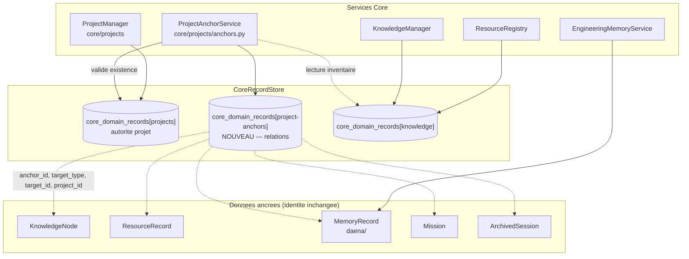

# DAĒNĀ P2.8.2 — Project Anchors (ancrages projet)

> Mécanisme de rattachement des connaissances et des données ETHAN à un
> projet, sans duplication de contenu et sans modification de l'identité des
> données.

**Statut :** IMPLEMENTED · TESTED
**Prérequis :** P2.8.0 et P2.8.1 clôturées
**Phase :** DAĒNĀ P2.8.2 — Mission 02, Stabilisation fonctionnelle

---

## 1. Objectif

Un *Project Anchor* identifie explicitement le projet auquel appartient une
information, tout en conservant :

- son **identité propre** (identifiant, titre, provenance) ;
- son **contenu** (non dupliqué) ;
- ses **relations** (KnowledgeConnection, métadonnées, composants).

Le rattachement est exploitable par ETHAN Core, DAĒNĀ, KnowledgeManager,
Engineering Memory, ResourceRegistry, les agents, les interfaces WebUI et CLI,
et les futurs mécanismes de recherche et de RAG.

---

## 2. Cartographie des modèles concernés

État vérifié **avant** modification : aucun des cinq modèles ne portait de
champ `project_id`.

| Modèle | Fichier | `project_id` avant | Nature de la donnée |
|---|---|---|---|
| `MemoryRecord` | `core/engineering_memory/models.py:52` | ❌ aucun | document d'ingénierie, partageable |
| `KnowledgeNode` | `core/knowledge/types.py:62` | ❌ aucun | connaissance synthétisée, partageable |
| `ResourceRecord` | `core/resources/registry.py` | ❌ aucun | ressource du dépôt, partageable |
| `Mission` | `core/missions/types.py` | ❌ aucun | chantier — **exclusif** |
| `ArchivedSession` | `core/knowledge/agent_traces/types.py:68` | ❌ aucun | trace de session — **exclusif** |

### Précédents existants dans le dépôt

| Précédent | Emplacement | Apport |
|---|---|---|
| Ancrage direct | `core/state/chats.py:40` (`project_id` sur un chat) | Une conversation appartient à **un** projet |
| Multi-projet | `core/dedup/types.py:68` (`project_ids`) | Une donnée dédupliquée peut concerner **plusieurs** projets |
| Relation projet → connaissance | `core/projects/__init__.py:459` (`knowledge_ids`) | Liste de contexte **déclarée** par le projet |
| Pseudo-projet | `core/projects/__init__.py:423` (`general`) | Portée « sans projet », jamais écrit en base |

---

## 3. Architecture retenue

### 3.1 Relation dédiée, et non champ identique

Le rattachement passe par une **relation dédiée** dans le domaine
`core_domain_records[project-anchors]`, et non par un champ `project_id`
ajouté à chacun des cinq modèles.

| Critère | Champ identique sur 5 modèles | Relation dédiée (retenu) |
|---|---|---|
| Multi-projet | impossible sans liste partout | natif |
| Provenance du rattachement | dans le modèle de contenu | dans la relation |
| Migration de schéma | requise (5 modèles) | **aucune** |
| Données historiques | à réécrire | **inchangées**, restent `GLOBAL` |
| Chemin de requête | 5 variantes | **un** |
| Isolation projet | à réimplémenter 5 fois | **une règle** |

Le mission demandait de « ne pas supposer que tous les modèles doivent
recevoir un champ identique » : la relation dédiée est retenue pour cette
raison, et parce qu'elle évite toute migration de données existantes.

### 3.2 Modèle

```python
@dataclass(frozen=True)
class ProjectAnchor:
    anchor_id: str          # UUIDv5 déterministe (type, cible, projet)
    target_type: AnchorTargetType
    target_id: str
    project_id: str
    created_at: str
    actor: str              # auteur ou composant producteur du rattachement
    metadata: dict          # origine, motif
    detached_at: str | None # None = actif
```

L'ancrage est **une relation** : elle ne contient jamais le contenu de la
donnée ancrée, seulement son adresse et sa provenance de rattachement.

### 3.3 Types cibles et politique d'exclusivité

| `AnchorTargetType` | Donnée | Politique | Justification |
|---|---|---|---|
| `knowledge_node` | `KnowledgeNode` | partageable | une connaissance sert plusieurs chantiers |
| `resource` | `ResourceRecord` | partageable | un composant de code sert plusieurs projets |
| `memory_record` | `MemoryRecord` | partageable | une décision d'architecture concerne souvent plusieurs projets |
| `mission` | `Mission` | **exclusif** (0..1) | un chantier appartient à un projet |
| `session` | `ArchivedSession` | **exclusif** (0..1) | une session d'agent travaille dans un projet |

La règle d'exclusivité est appliquée par le service : rattacher une session à
un second projet est **refusé** avec une erreur explicite.

### 3.4 Portée — dérivée, jamais stockée

| Portée | Condition | Calcul |
|---|---|---|
| `GLOBAL` | aucune ancre active | `len(anchors) == 0` |
| `PROJECT` | exactement une ancre active | `len(anchors) == 1` |
| `MULTI_PROJECT` | plusieurs ancres actives | `len(anchors) > 1` |

Un champ de portée stocké finirait par contredire les ancres. La portée est
donc **calculée** à partir des relations, et exposée par
`scope_for(target_type, target_id)`.

### 3.5 Identité et validation

| Aspect | Règle |
|---|---|
| Identifiant canonique | `project.id` — UUID4 à la création, **stable** ensuite |
| Existence | `validate_project()` refuse un projet absent |
| Projet inactif | refusé pour un **nouveau** rattachement ; les ancres existantes restent valides et résolubles |
| Identifiant d'ancre | UUIDv5 de `(target_type, target_id, project_id)` → rattachement idempotent |
| Renommage du projet | sans impact : l'ancre ne dénormalise que l'identifiant |

### 3.6 Schéma



### 3.7 Responsabilités des services

| Service | Responsabilité | Ce qu'il ne fait pas |
|---|---|---|
| `ProjectAnchorService` | rattachement, détachement, portée, isolation, validation du projet | ne stocke pas le contenu ancré |
| `ProjectManager` | cycle de vie des projets (création, nom unique, activité) | ne connaît pas les ancres |
| `KnowledgeManager` | nœuds de connaissance | inchangé — l'ancrage est externe |
| `ResourceRegistry` | ressources et documents | inchangé |
| `EngineeringMemoryService` | documents d'ingénierie | inchangé |
| Routeur API | validation HTTP, délégation, projection | **aucune** règle métier |

### 3.8 Contrat du repository

| Opération | Contrat |
|---|---|
| `attach(type, target, project, actor, metadata)` | idempotent ; refus si projet inconnu/inactif ; refus si catégorie exclusive déjà rattachée |
| `detach(type, target, project)` | marque l'ancre détachée ; **ne supprime pas** la donnée ; l'historique est conservé |
| `anchors_for(type, target, include_detached)` | ancres actives (ou historiques) d'une donnée |
| `scope_for(type, target)` | `GLOBAL` / `PROJECT` / `MULTI_PROJECT` |
| `projects_for(type, target)` | projets d'une donnée |
| `targets_for_project(project, type=None)` | données ancrées à un projet |
| `global_targets(type)` | données sans aucune ancre active |
| `filter_by_project(candidates, project, type)` | **règle d'isolation** |

### 3.9 Isolation

```python
visible = await service.filter_by_project(
    candidate_ids, project_id, AnchorTargetType.KNOWLEDGE_NODE
)
```

Règle : un candidat **exclusif** d'un autre projet n'est **jamais**
retourné. Les candidats globaux le sont si `include_global` est vrai. Une
donnée multi-projets apparaît dans chacun des projets concernés.

---

## 4. Modèle de données persisté

`core_domain_records[project-anchors]` :

```json
{
  "anchor_id": "6b1f...-...",
  "target_type": "knowledge_node",
  "target_id": "d3cc7e0a-0dd7-5fda-a394-dfa76e4442c6",
  "project_id": "45ee1055-540e-4cfd-b1c6-29d2d9b1dbae",
  "created_at": "2026-11-12T09:41:12.334512Z",
  "actor": "agent-architect",
  "metadata": {"origin": "session", "reason": "chantier DAENA"},
  "detached_at": null
}
```

---

## 5. Exposition aux consommateurs autorisés

| Route | Permission | Rôle |
|---|---|---|
| `GET /v1/projects/{id}/anchors` | `READ` | liste les données ancrées |
| `POST /v1/projects/{id}/anchors` | `MEMORY` | rattache une donnée (idempotent) |
| `DELETE /v1/projects/{id}/anchors/{type}/{target}` | `MEMORY` | détache sans supprimer la donnée |
| `GET /v1/projects/{id}/anchors/{type}/{target}/scope` | `READ` | portée et projets d'une donnée |

Le service est branché dans `interfaces/api/main.py` sur le `domain_store`
partagé — même source de vérité que les autres services Core. La résolution
d'existence de projet lit le domaine `projects` : **aucune logique métier dans
l'interface**.

---

## 6. Données historiques — compatibilité

| Cas | Traitement |
|---|---|
| 100 `KnowledgeNode` en base, sans ancre | restent `GLOBAL` ; aucun projet inventé |
| 118 `MemoryRecord` du vault, sans ancre | restent `GLOBAL` |
| 536 `ResourceRecord` du registre, sans ancre | restent `GLOBAL` |
| Rattachement ultérieur | possible explicitement, à tout moment |

**Aucune migration n'est nécessaire ni préparée** : la relation est additive,
le schéma des cinq modèles est inchangé, et les données historiques restent
exploitables.

---

## 7. Tests

```bash
cd AI/Ethan
.venv/bin/python -m pytest tests/core/test_project_anchors.py -q
# 26 passed
```

| Domaine | Test |
|---|---|
| Création d'un ancrage | `test_attach_creates_an_anchor` |
| Rattachement à un projet existant | `test_attach_creates_an_anchor` |
| Rejet d'un identifiant invalide | `test_unknown_project_is_rejected`, `test_empty_project_id_is_rejected`, `test_inactive_project_is_rejected`, `test_empty_target_id_is_rejected` |
| Informations globales | `test_unanchored_data_is_global`, `test_historical_data_without_anchor_stays_global` |
| Informations rattachées | `test_anchored_data_is_project_scoped` |
| Partage multi-projets | `test_multi_project_sharing`, `test_exclusive_target_refuses_second_project` |
| Recherche avec filtrage projet | `test_filter_by_project_keeps_global_and_own`, `test_targets_for_project_lists_only_its_own` |
| Isolation entre projets | `test_filter_by_project_keeps_global_and_own` |
| Préservation de la provenance | `test_anchor_preserves_provenance`, `test_detach_preserves_history` |
| Persistance et relecture | `test_attach_persists_to_the_store`, `test_anchor_survives_a_simulated_restart` |
| Compatibilité historique | `test_historical_data_without_anchor_stays_global`, `test_anchor_domain_is_dedicated` |
| Redémarrage simulé | `test_anchor_survives_a_simulated_restart` |
| Non-régression | `test_knowledge_manager_non_regression`, `test_engineering_memory_non_regression`, `test_p2_8_0_destinations_non_regression`, `test_p2_8_1_persistence_non_regression` |

Non-régression globale : suite `tests/core/` = **910 passés** (884 + 26), 27
échecs et 8 erreurs **strictement identiques** à la référence pré-existante.

---

## 8. Limites connues

| Limite | Impact | Traitement |
|---|---|---|
| Le `ResourceRegistry` n'est pas encore branché sur le store partagé | les ancres de type `resource` n'ont pas encore de cible réelle en production | **P2.8.6** |
| Les `Mission` ne sont pas persistés en production (`missions` = 0 ligne) | ancres de type `mission` non exerçables en runtime | hors périmètre |
| Les `ArchivedSession` vivent dans le vault `Odsidian`/sessions, hors store | l'inventaire des cibles `session` n'est pas résolvable par le service | P2.8.7 |
| L'inventaire des cibles globales ne couvre que `knowledge` et `resources` | `global_targets()` renvoie une liste vide pour les autres types | assumé, documenté |
| Aucun ConsumerCore n'exploite encore les ancres pour filtrer une recherche | le filtrage projet existe comme API Core, pas encore appliqué aux managers | phases ultérieures |
| Pas de validation RUNTIME de l'API (routes protégées par authentification) | les routes sont syntaxiquement et structurellement validées, pas exécutées en conditions authentifiées | opérateur |

---

## 9. Migrations

**Aucune migration n'est requise.** La relation `project-anchors` est additive et
n'altère aucun modèle existant.

Si un jour une **dénormalisation** du projet dans les ancres est souhaitée
(par exemple pour éviter une jointure), elle devra être préparée et
autorisée séparément.

---

## 10. Décisions

- **D-008** dans `docs/memory/DECISIONS.md` : relation dédiée plutôt que champ
  identique sur cinq modèles ; portée dérivée ; unicité d'ancre déterministe ;
  règle d'exclusivité pour les missions et sessions.

---

## 11. Sources

- `core/projects/anchors.py` — modèle, repository, service
- `interfaces/api/routers/projects.py` — routes d'ancrage (délégation)
- `interfaces/api/main.py` — câblage du service sur le store partagé
- `tests/core/test_project_anchors.py` — 26 tests
- `docs/memory/DECISIONS.md` — D-008
- `docs/architecture/dana-p2-8-1-persistence-unification.md` — persistance

---

# Consolidation P2.8.2 (2026-11-12, après P2.8.3)

> Cette section est **ajoutée chronologiquement**. Les constats des sections
> 1 à 11 restent valables : ils décrivent l'état d'origine de la phase. La
> consolidation corrige des défauts de robustesse qui n'invalident pas
> l'architecture retenue, mais en fortcicent l'application.

Mission : consolidation fonctionnelle complète des Project Anchors avant
toute progression de la feuille de route.

## 12. Défauts constatés et corrections

| # | Défaut | Cause racine | Correction |
|---|---|---|---|
| A1 | **La réactivation d'une ancre détachée ignorait l'exclusivité.** Une cible exclusive détachée du projet A pouvait être réactivée alors que le projet B la possédait déjà. | Le contrôle d'exclusivité n'était placé que sur le chemin de **création**. | Le contrôle est appliqué sur **tous** les chemins : création, réactivation, rattachement répété. |
| A2 | **Contrôle puis écriture : la concurrence n'était pas gérée.** Deux rattachements concurrents d'une cible exclusive pouvaient passer le contrôle avant que l'une des écritures ne soit visible. | Le `CoreRecordStore` n'offre ni transaction, ni verrou, ni écriture conditionnelle : `save()` est un upsert simple. | Nouvelle primitive `CoreRecordStore.atomic(guard)` : transaction PostgreSQL réelle + `pg_advisory_xact_lock` ; repli `asyncio.Lock` par clé sans PostgreSQL. Le contrôle **et** l'écriture se font dans cette section. |
| B1 | **L'existence des cibles n'était jamais vérifiée.** Rattacher une cible inexistante créait une relation vers rien. | Aucun résolveur d'existence n'existait. | Résolution auprès de la **vraie source** de chaque type (§13), avec verdict `verified` / `not_found` / `unresolvable` consigné dans l'historique de l'ancre. |
| C1 | **Une panne du store était transformée en « projet introuvable ».** | `get_project()` avalait toute exception et renvoyait `None` ; `validate_project()` en déduisait « Project not found ». | Méthodes strictes `get_strict` / `list_strict` / `save_strict` sur le store ; exception dédiée `ProjectAnchorStoreUnavailable` (technique) distincte de `ProjectAnchorError` (règle métier). Une panne → **503**, une règle violée → **422**. |
| C2 | **Un inventaire inaccessible renvoyait silencieusement une liste vide.** | `_list_target_ids()` absorbait toute exception et renvoyait `[]`. | Remplacé par `inventory()` qui renvoie un `TargetInventory` porteur de son état ; l'API expose `status: ok \| unavailable` avec le motif. |
| D1 | **`detach()` ne validait aucun identifiant.** Un `target_id` vide, un `project_id` vide ou un type inconnu produisaient une ancre fantôme ou une `ValueError` non traduite. | `detach()` n'utilisait pas la validation de `attach()`. | Validation unique `_validate_identifiers()` partagée par `attach()` et `detach()` : type reconnu, identifiants non vides, **normalisation identique** des deux côtés (bord normalisé, contenu jamais réécrit). |
| E1 | **La réactivation effaçait silencieusement les métadonnées d'origine.** | `metadata=dict(metadata or anchor.metadata)` : les métadonnées nouvelles remplaçaient les anciennes. | Les cycles sont conservés dans `history` : chaque cycle porte sa date, son auteur, ses métadonnées, sa date de détachement et le verdict d'existence. Les métadonnées d'origine restent lisibles. |
| E2 | **Un état courant ne permettait pas de reconstituer les cycles.** | Le modèle ne portait qu'un couple `created_at` / `detached_at`. | Champ `history` (cycles) ajouté — **rétrocompatible** : une ancre antérieure sans `history` est reconstituée avec un cycle implicite dérivé de son état courant. |
| F1 | **`filter_by_project()` était quadratique.** Une lecture complète du domaine des ancres par candidat. | `anchors_for()` était appelé dans la boucle. | Index des ancres actives construit en **une** lecture (`_active_anchor_index`). |
| F2 | **Filtrer pour un projet inexistant ou inactif était accepté.** | Aucune validation du projet avant filtrage. | Le projet est validé avant tout filtrage (échec fermé). |
| G1 | **Les routes ne distinguaient pas panne et règle métier** ; un `ProjectAnchorStoreUnavailable` aurait produit un 500 avec trace. | Seul `ProjectAnchorError` était capturé. | Traduction explicite : `ProjectAnchorStoreUnavailable` → **503**, `ProjectAnchorError` → **422**. |
| G2 | **`detach()` ne capturait aucune erreur** : une validation invalide produisait un 500. | Aucun `try/except` dans la route. | Même traduction que `attach()`. |

### 12.1 Capacités réelles du `CoreRecordStore`

Le store ne fournissait **aucune** garantie de concurrence :

- `save()` : upsert simple, sans transaction ;
- `get()` / `list()` : avalent les pannes d'infrastructure et renvoient
  `None` / `[]` ;
- aucun verrou, aucune écriture conditionnelle.

La correction est **minimale et compatible** : trois méthodes strictes
(`get_strict`, `list_strict`, `save_strict`) et une section critique
(`atomic`). **Aucune nouvelle base, aucun nouveau daemon, aucune migration,
aucun changement de schéma** : la section critique s'appuie sur le
mécanisme transactionnel PostgreSQL déjà présent.

## 13. Résolution de l'existence des cibles

| Type | Source réelle | État |
|---|---|---|
| `KNOWLEDGE_NODE` | domaine `knowledge` (`KnowledgeManager`) | résolvable |
| `RESOURCE` | domaine `resources` (`ResourceRepository`) | résolvable **si alimenté** (registre non branché : P2.8.6) |
| `MISSION` | domaine `missions` (`MissionManager`) | résolvable |
| `MEMORY_RECORD` | corpus documentaire (vault Engineering Memory) | résolvable via un résolveur injecté ; sinon **non résolvable** |
| `SESSION` | sessions archivées non persistées | **non résolvable** (P2.8.7) |

Deux règles gouvernent le verdict :

1. **source alimentée + cible absente** → `not_found` → le rattachement est
   **refusé** ;
2. **source non alimentée ou inaccessible** → `unresolvable` → le
   rattachement est **accepté**, mais l'ancre consigne explicitement que
   l'existence **n'a pas été établie** (`target_existence: unresolvable`).
   Aucune existence n'est prétendument vérifiée.

Un domaine *vide* ne prouve pas qu'une donnée est absente : il prouve que
la source n'est pas alimentée. C'est pourquoi un domaine vide est traité
comme `unresolvable` et non comme `not_found`.

Le résolveur des documents d'ingénierie est injecté par l'API
(`build_memory_record_resolver`), qui interroge le **vault** — la vraie
source — dans un thread pour ne pas bloquer la boucle événementielle.

## 14. Isolation — ce qui est démontré et ce qui ne l'est pas

| Niveau | Statut |
|---|---|
| Filtrage disponible dans `ProjectAnchorService` | **TESTED** (22 tests dédiés) |
| Filtrage effectivement appliqué par un consommateur | **PARTIAL** — les routes d'ancrage l'exposent ; `KnowledgeManager` et le pipeline RAG ne sont **pas** branchés sur les ancres (P2.8.3 → P2.8.8, hors périmètre) |
| Isolation validée en conditions de production | **NOT_VERIFIED** — aucun projet réel n'est ancré en production ; l'isolation n'est démontrée que sur store isolé |

Les cas couverts par les tests : GLOBAL, PROJECT, MULTI_PROJECT, cible
exclusive d'un autre projet, cible détachée redevenue globale, projet
inexistant ou inactif, `include_global=False`, isolation entre deux
projets.

## 15. Routes API

| Méthode | Route | Permission | Erreurs |
|---|---|---|---|
| `GET` | `/v1/projects/{project_id}/anchors` | `READ` | 422 / 503 |
| `GET` | `/v1/projects/{project_id}/anchors/global` | `READ` | 422 / 503 |
| `POST` | `/v1/projects/{project_id}/anchors` | `MEMORY` | 422 / 503 |
| `DELETE` | `/v1/projects/{project_id}/anchors/{target_type}/{target_id}` | `MEMORY` | 404 / 422 / 503 |
| `GET` | `/v1/projects/{project_id}/anchors/{target_type}/{target_id}/scope` | `READ` | 422 / 503 |

La route `anchors/global` est **ajoutée** par la consolidation : elle expose
la distinction « liste réellement vide » / « inventaire indisponible », que
le silence ne permettait pas de rendre.

Aucune logique métier n'est dupliquée dans le routeur : les cinq routes
délèguent au service Core et se contentent de traduire ses erreurs.

## 16. Tests

| Fichier | Avant | Après |
|---|---|---|
| `tests/core/test_project_anchors.py` | 26 | **48** (+22) |
| `interfaces/api/tests/test_project_anchors_api.py` | — | **17** |

Les deux tests de régression de defect sont **détecteurs de défaut** : ils
ont été vérifiés en neutralisant successivement la section critique (A2) et
le contrôle de réactivation (A1) — ils échouent alors, et passent avec les
correctifs.

## 17. Limites restantes après consolidation

| Limite | Statut |
|---|---|
| `KnowledgeManager` et le pipeline RAG ne sont pas branchés sur les ancres | Hors périmètre — ordre P2.8.3 → P2.8.8 |
| `ResourceRegistry` non branché sur le store partagé : le domaine `resources` est vide en production | Hors périmètre (P2.8.6) |
| Sessions archivées non persistées : source `SESSION` non résolvable | Hors périmètre (P2.8.7) |
| Le résolveur des documents d'ingénierie parcourt le vault (≈ 0,5 s) | Accepté pour une opération d'ancrage ; optimisation possible (P2.8.4+) |
| Aucune donnée d'ancrage réelle en production | La validation E2E authentifiée reste à faire avec un identifiant opérateur autorisé |
| Le rôle `api-key` n'a aucune permission RBAC : les routes d'ancrage sont réservées aux sessions humaines | Constaté ; le mécanisme par portée existe (`require_memory_scope`) mais n'a pas été appliqué ici — hors périmètre |
