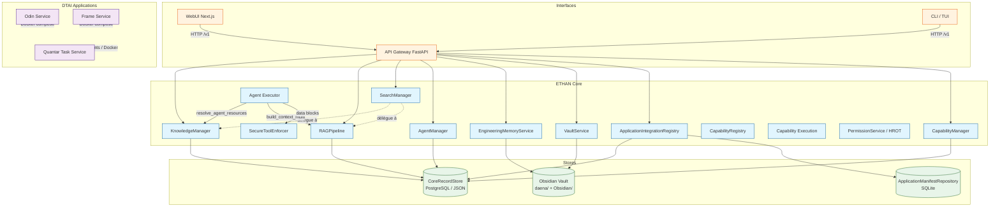
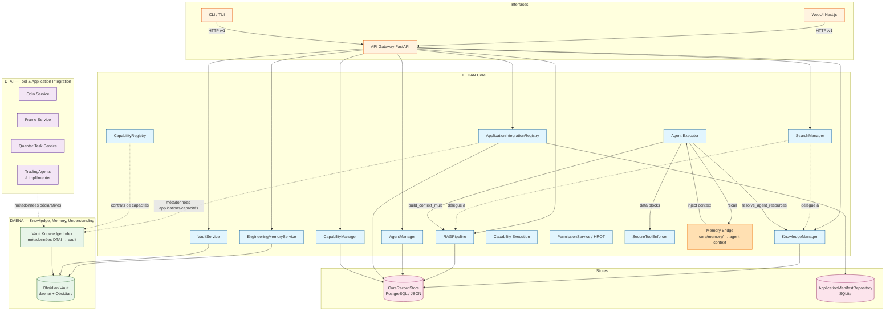
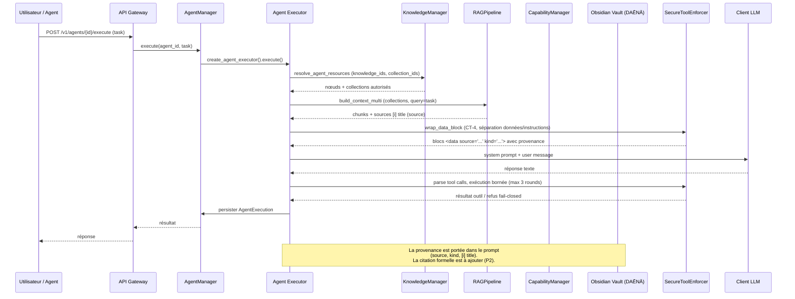

# DAENA_DTAI_ARCHITECTURE.md

Architecture cible proposée pour ETHAN OS, articulée autour de DAĒNĀ (connaissance, mémoire, compréhension), ETHAN Core (moteur central) et DTAI (intégration et gestion des outils et applications). Basée sur les éléments réellement présents dans le dépôt, sans hypothèse non étayée.

---

## 1. Principes directeurs

| Principe | Conséquence architecturale |
|----------|---------------------------|
| ETHAN Core reste le moteur central | Tous les services métier (agents, knowledge, RAG, memory, capabilities) vivent dans `core/`. Les interfaces ne font que révéler et contrôler. |
| DAĒNĀ est le système de connaissance, mémoire et compréhension | Le vault Obsidian (`daena/` + `Obsidian/`), l'Engineering Memory et le Knowledge/RAG sont les seules sources de connaissance durable. |
| DTAI est le système d'intégration et de gestion des outils et applications | Le registre d'applications, le capability manager, les contrats de capacités et le cycle de vie Docker vivent dans `core/applications/` et `core/capability_manager/`. |
| Les agents consomment les capacités par des contrats explicites | `resolve_agent_resources` + `invoke_capability` + schéma JSON Schema d'entrée/sortie. Pas de ressource globale implicite. |
| WebUI et CLI restent deux interfaces du même Core | Aucune logique métier ne migre dans les interfaces (règle AGENTS.md WebUI). |
| Python conserve l'orchestration, les agents, le RAG et les services métier | Pas de migration de logique métier vers un autre langage. |
| Rust complète Python uniquement pour les besoins spécialisés justifiés | Aucun besoin Rust identifié dans l'état actuel ; cette option reste ouverte mais non déclenchée. |
| Pas de duplication de logique métier | Un seul chemin pour le retrieval RAG, un seul registre d'applications, un seul cycle de vie. |
| Permissions explicites, HROT et moindre privilège | `PermissionService` + `CapabilityAuthorizationService` + `SecureToolEnforcer` (fail-closed) sur tous les chemins d'exécution. |
| Traçabilité des opérations et provenance des connaissances | Audit trail (`AuditStore`, `EventBus`, `MEMORY_EVENT_LOG.ndjson`), `manifest_fingerprint`, provenance `<data source="...">` dans les prompts agent. |
| DAĒNĀ n'est PAS le gestionnaire du cycle de vie des applications | DAĒNĀ lit et indexe les métadonnées DTAI ; DTAI gère son propre cycle de vie. Pas de dépendance circulaire. |

---

## 2. Architecture actuelle constatée (diagramme Mermaid)



### Constats structurants de l'architecture actuelle

1. **Aucun mécanisme commun d'accès Knowledge pour les agents** : l'exécuteur d'agent précharge le contexte dans le system prompt (`resolve_agent_resources` + `build_context_multi`). Pas de retrieval autonome à la volée.
2. **Mémoire cognitive `core/memory/` non branchée** : les 8 types de mémoire (Working, Episodic, Semantic, Vector…) ne sont pas appelés dans le flux d'exécution agent.
3. **Pas de citation formelle** : la provenance est dans le prompt (`<data source="...">`), pas extraite de la réponse LLM.
4. **Routeurs orphelins** : `knowledge.py` et `engineering_memory.py` définis mais non montés dans `main.py`.
5. **Duplication OdinService vs ComposeService** (~700 lignes).
6. **Pas d'indexation DTAI dans DAĒNĀ** : pas de contrat explicite entre `ApplicationIntegrationRegistry`/`CapabilityRegistry` et `VaultService`/`KnowledgeManager`.
7. **TradingAgents absent** (proposition de manifest uniquement dans un test).

---

## 3. Architecture cible proposée (diagramme Mermaid)



### Principaux changements par rapport à l'existant

| Élément | Actuel | Cible |
|---------|--------|-------|
| Mémoire cognitive | Non branchée aux agents | Bridge `core/memory/` → contexte agent (P1) |
| Citations | Absentes (provenance dans le prompt uniquement) | Mécanisme de citation formelle extrait de la réponse LLM (P2) |
| Comptage de tokens | Absent (8000 caractères bruts) | Comptage basé sur `ModelInfo.context_length` (P1) |
| HROT dans l'exécution agent | Non appelé | `CapabilityAuthorizationService` intégré dans `executor.py` (P2) |
| Routeurs orphelins | `knowledge.py`, `engineering_memory.py` non montés | Montés ou supprimés pour éviter la confusion (P0) |
| Duplication Odin/ComposeService | ~700 lignes dupliquées | `OdinService` hérite de `ComposeService` (P2) |
| Indexation DTAI → DAĒNą | Absente | Contrat explicite : métadonnées applications/capacités indexées dans le vault (P2) |
| TradingAgents | Absent | Intégration ETHAN complète (manifest, registre, plugin, endpoints) (P2) |

---

## 4. Flux de connaissance entre DAĒNĀ, ETHAN Core et les agents



---

## 5. Cycle de vie d'une intégration DTAI

```mermaid
stateDiagram-v2
    [*] --> Découverte
    Découverte --> Validation : contrat valide
    Validation --> Enregistrement : approved=true
    Enregistrement --> ContratCapabilité : binding + activate
    ContratCapabilité --> Installation : install()
    Installation --> Démarrage : start()
    Démarrage --> Exécution : invoke_capability
    Exécution --> Arrêt : stop()
    Arrêt --> Désinstallation : uninstall()
    Désinstallation --> [*]
    
    note right de Découverte : LocalRepositoryDiscovery /<br/>ApplicationDiscoveryService (read-only)
    note right de Validation : ContractValidator (valid/invalid/<br/>incomplete/incompatible)
    note right de Enregistrement : ApplicationIntegrationRegistry<br/>état REGISTERED/VALIDATED
    note right de Installation : CapabilityManager (opération persistée,<br/>24h/50 max, réconciliation)
    note right de Exécution : invoke_capability (jsonschema input,<br/>TRUSTED_IMPLEMENTATION_ALIASES, fail-closed)
    note right de Arrêt : stop() + test() (santé réelle)
```

**Règles du cycle de vie :**
- Aucune exécution du code découvert (read-only jusqu'à approbation explicite).
- `delete()` du manifest durable lève `NotImplementedError` (retrait par policy, pas suppression silencieuse).
- Les bindings de capacité doivent être persistés au-delà du processus (à implémenter, P2).

---

## 6. Flux documentaire complet jusqu'à la réponse d'un agent

```mermaid
flowchart TD
    A[Document source<br/>fichier / URL / nœud Knowledge] -->|ingest| B[RAGPipeline.ingest<br/>chunking + embedding]
    B -->|stockage| C[CoreRecordStore<br/>domaine rag-documents]
    C -->|indexation| D[Vector store<br/>mémoire ou ChromaDB/Qdrant]
    D -->|retrieve| E[RAGPipeline.retrieve<br/>stratégie auto/keyword/semantic/hybrid]
    E -->|chunks + sources| F[RAGContext.build_context<br/>max_context_chars, sources]
    F -->|contexte texte| G[Agent Executor<br/>system prompt]
    G -->|données <data>| H[LLM]
    H -->|réponse| I[Utilisateur]
    
    subgraph Knowledge
    J[Nœud Knowledge<br/>KnowledgeManager.create]
    J -->|ingest_into_rag explicite| B
    end
    
    subgraph DAĒNĀ
    K[Obsidian Vault<br/>VaultService read-only]
    K -->|recherche plein texte| L[Search / Graph / Backlinks]
    L -->|résultats| G
    end
    
    subgraph Provenance
    M[<data source="rag:..." kind="rag">]
    N[[i] title (source)]
    M --> G
    N --> G
    end
    
    style A fill:#e1f5fe,stroke:#01579b
    style I fill:#e8f5e9,stroke:#1b5e20
```

**Rupture documentée** : entre `H` (LLM) et `I` (utilisateur), il n'existe pas de mécanisme de citation formelle extrait de la réponse (P2).

---

## 7. Contrats explicites entre DAĒNĀ et DTAI

### 7.1 Contrat DTAI → DAĒNĀ (lecture seule, pas de cycle de vie)

DAĒNĀ indexe, en lecture seule, les métadonnées déclaratives des applications et capacités DTAI :

| Donnée indexée | Source DTAI | Destination DAĒNĀ | Usage |
|----------------|-------------|-------------------|-------|
| Manifest d'application (app_id, name, version, publisher) | `ApplicationIntegrationRegistry` | Vault / Knowledge nodes (type SOURCE) | Répertoire des applications connues |
| Contrat de capacité (capability_id, category, input/output_schema) | `CapabilityRegistry` / `capability_contract.py` | Knowledge nodes (type RULE) | Découverte des capacités par les agents |
| État de cycle de vie (REGISTERED, AVAILABLE, RUNNING…) | `ApplicationIntegrationRegistry` / `CapabilityManager.status()` | Engineering Memory records (type COMPONENT) | Traçabilité opérationnelle |
| Empreinte du manifeste (`manifest_fingerprint`) | `core/applications/permissions.py` | Vault (évidence) | Détection de modification post-autorisation |

**Règle** : DAĒNĀ ne démarre, n'arrête, n'installe ni ne désinstalle aucune application. DTAI garde la pleine responsabilité de son cycle de vie.

### 7.2 Contrat DAĒNĀ → agents (lecture)

| Donnée | Source DAĒNĀ | Destination | Mécanisme |
|--------|--------------|-------------|-----------|
| Nœuds de connaissance (CONCEPT, FACT, RULE, ENTITY, SOURCE, DOCUMENT) | `KnowledgeManager` | Agents | `resolve_agent_resources` → `<data source="knowledge:...">` |
| Documents RAG (collections) | `RAGPipeline` + `KnowledgeCollectionManager` | Agents | `build_context_multi` → `<data source="rag:...">` |
| Métadonnées applications/capacités DTAI | Vault indexé (DTAI → DAĒNĀ) | Agents | même chemin Knowledge/RAG |
| Records Engineering Memory (décisions, incidents, dépendances) | `EngineeringMemoryService` | Agents | à brancher via `core/memory/` bridge (P1) |

### 7.3 Prévention de la dépendance circulaire

- DTAI n'importe aucun module de DAĒNĀ (VaultService, KnowledgeManager) pour son cycle de vie.
- DAĒNĀ lit les métadonnées DTAI via l'API publique (`/v1/applications`, `/v1/application-capabilities`, `/v1/application-integration/catalog`) ou via `CoreRecordStore`, jamais en appelant directement les services DTAI.
- L'indexation DTAI → DAĒNĀ est un flux unidirectionnel (déclaratif, lecture seule).

---

## 8. Responsabilités par composant

| Composant | Responsabilité | Ne doit PAS |
|-----------|---------------|-------------|
| ETHAN Core | Orchestration, agents, RAG, knowledge, memory, permissions, HROT | Logique d'interface (WebUI/CLI) |
| DAĒNĀ (Vault + Engineering Memory + Knowledge) | Stockage durable de la connaissance, mémoire technique, provenance, graphe de documents | Gestion du cycle de vie des applications |
| DTAI (ApplicationIntegrationRegistry + CapabilityManager) | Enregistrement, cycle de vie, exécution des applications et capacités | Définir la connaissance métier ETHAN |
| Agents | Consommer les capacités par contrats explicits | Injecter des ressources globales implicites |
| Interfaces (WebUI/CLI) | Révéler et contrôler via l'API | Implémenter la logique métier |

Fin de l'architecture cible.
