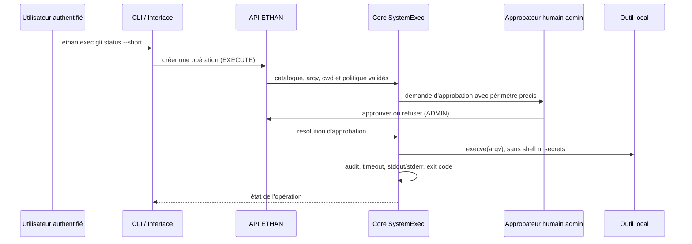

# Exécution système contrôlée

La capacité `core.system_exec` permet à ETHAN de demander des opérations
locales strictement bornées. Elle n'est ni un terminal interactif ni un shell
générique. Les interfaces utilisent les routes `/v1/system/exec/*`; elles ne
lancent aucun processus elles-mêmes.

## Chaîne de confiance



Une identité avec `EXECUTE` peut demander une opération. Seul un administrateur
peut résoudre l'approbation. Une approbation porte sur une opération et son
`argv` précis; elle ne remet jamais une capacité générale à un agent, plugin,
skill ou MCP.

## Contraintes de sécurité

- Pas de `/bin/sh`, `shell=True`, interpolation de commande ou `sudo`.
- Le catalogue est fermé. Les formes actuellement acceptées sont en lecture
  seule : `ollama list|ps|show`, `git status|log|diff|branch|rev-parse` avec
  options limitées, et `python`, `python3`, `node` avec `--version`.
- Chaque commande catalogue nécessite une approbation humaine. Toute commande
  inconnue, tout argument imprévu et tout chemin de travail absolu est refusé.
- Le Core refuse de s'exécuter en root. Il n'effectue pas de changement
  d'utilisateur.
- Le cwd résolu reste sous `ETHAN_EXEC_ROOT`, défaut `/workspace`.
- L'environnement enfant est une allowlist (`PATH`, locale, fuseau); les
  tokens, mots de passe et secrets de l'API ne sont pas hérités.
- La politique Core refuse Docker. Cette capacité ne monte ni n'ouvre le
  socket Docker. La présence éventuelle d'un socket est du ressort du
  déploiement et ne rend pas Docker exécutable via cette API.
- stdout et stderr sont capturés séparément, bornés à 256 KiB chacun et
  redacted avant réponse/audit pour les motifs usuels de secrets.
- L'expiration, l'annulation et l'arrêt de l'API envoient un signal au groupe
  de processus de l'enfant. Les descendants connus ne restent pas actifs.

## API et utilisation CLI

`POST /v1/system/exec/operations` crée une opération et renvoie `202` avec son
identifiant. `GET /v1/system/exec/operations/{id}` donne son état; seul son
demandeur avec la permission `EXECUTE` peut le lire ou l'annuler. Les statuts
sont `PENDING_APPROVAL`, `RUNNING`, `COMPLETED`, `REFUSED`, `TIMED_OUT`,
`CANCELLED` et `ERROR`.

Le CLI appelle ces routes :

```bash
ethan exec catalogue
ethan exec ollama list --no-wait
ethan exec pending
ethan exec approve <approval-id>    # admin
ethan exec operation <operation-id>
```

Le CLI n'exécute pas l'outil local. Il reste fonctionnel contre un Core
distant: c'est le Core distant qui définit son catalogue, son utilisateur OS
et son répertoire contrôlé.

## Limites

Cette capacité ne remplace pas le terminal PTY existant. Elle n'offre pas de
flux de sortie temps réel dans cette version et ne permet pas les commandes
mutantes, les scripts Python/Node arbitraires, les pipes, redirections ou
installations de paquets. Étendre le catalogue demande une évolution du Core,
une politique explicite, des tests et une revue de sécurité.
